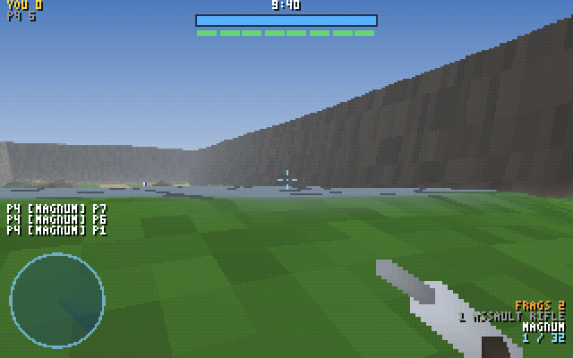
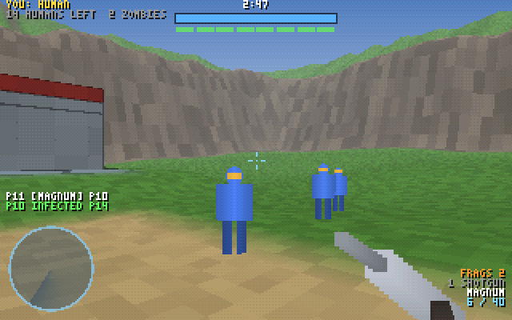
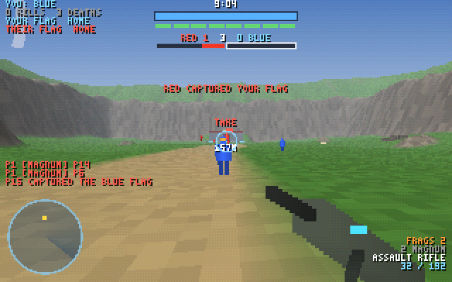
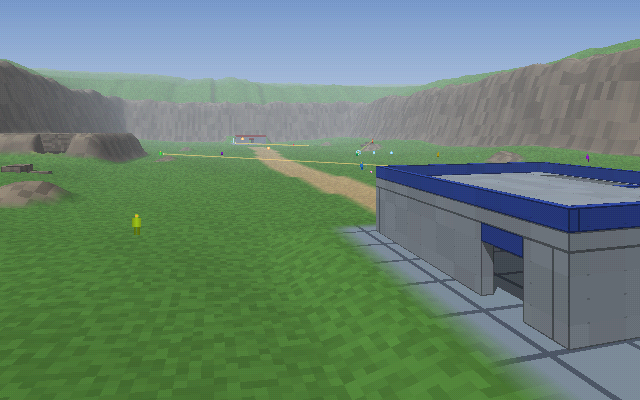
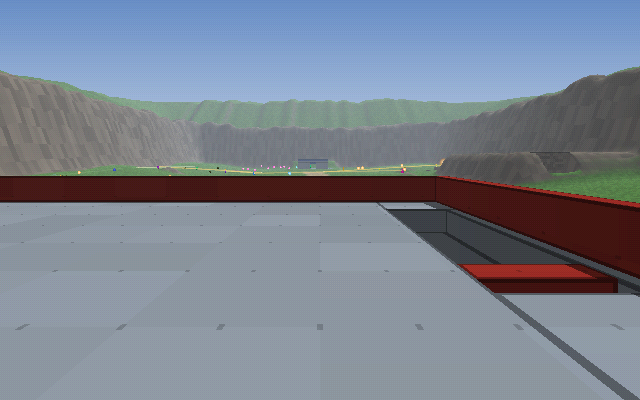
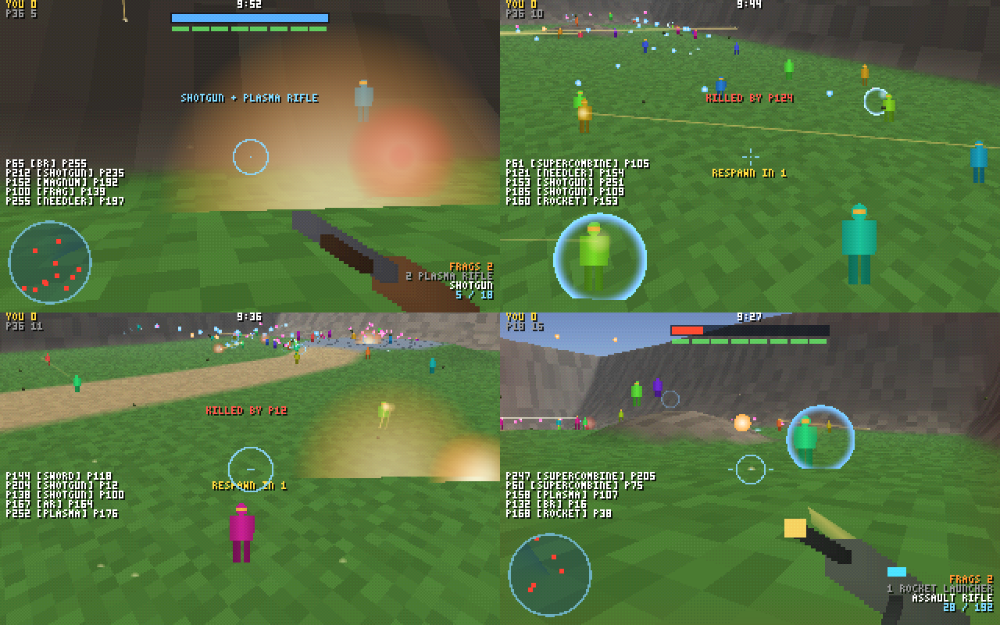
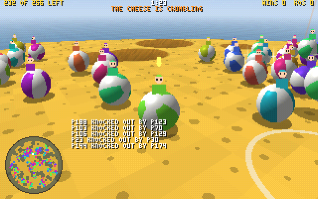
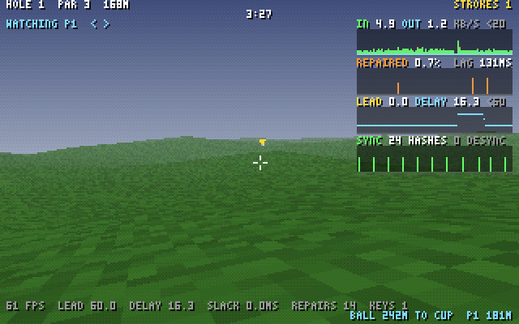
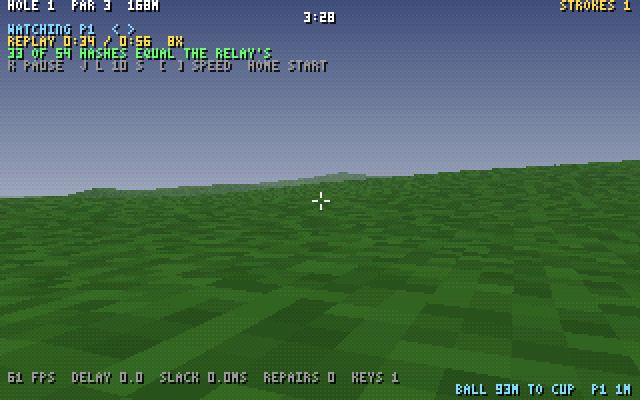

# Quake Golf

256 players in one room, one course, rockets and grenades as clubs, and every
ball ever hit stays in play. The sim is **hand-written WebAssembly** (no compiler), stepped in
deterministic lockstep at 125 Hz, so only inputs cross the network: bandwidth
follows players, never balls.

Design doc and netcode review: [Quake Golf — Design Doc](https://claude.ai/artifact/QTA2QtjNiu4HLWW2115bW7).
Target: the newest Chrome; the server is Deno. The same sim also runs as
Pentium III code on the original Xbox: see [X1](#x1-the-original-xbox).

**[Fireplace](#fireplace)** is all of it as one party game: the room plays
bumper balls, [Party](#party)'s minigames, the arena and golf in turn, Mario Party style, and people
come and go as they like, from a living room with a fire going and the game on
the TV. What comes next is [docs/roadmap.md](docs/roadmap.md).

## Where it is

| Milestone | Gate | Status |
| --- | --- | --- |
| P1 · Party | bumper balls' ball and a minigame a round, fourteen of them (Thin Ice, Color Call, Sweeper, Red Light, Bomb Rain, The Wall, Musical Pads, King of the Hill, Hot Potato, Coin Rush, Paint Party, Downhill, Fruit Chute, Tag), every stage on a schedule so the prediction is exact through it; a renderer for any stage in bumper balls' look; each minigame's AI rounds equal on every tick in Node, Deno and Chrome on 1, 2 and 4 threads, and online with every hash equal | **passed** · [Party](#party) |
| F1 · Fireplace | every game in one module, each bit for bit its own build; a playlist the room plays through, everyone moved into the next game on one tick, marshmallows for the top three; keyframes from any game restored into another's world; the playlist equal on every tick in Node, Deno and Chrome on 1, 2 and 4 threads, and online with every hash equal across a switch; a page that is a living room, the TV closing in to fill the screen | **passed** · [Fireplace](#fireplace) |
| B1 · bumper balls | every player a ball on a wheel of Swiss cheese whose holes are the golf cup made big: bump the others in, keep out yourself, the last ball rolling wins; the rim crumbling and the holes widening, power-ups dropping from the sky; rounds of AI balls equal on every tick in Node, Deno and Chrome on 1, 2 and 4 threads, and 256 online with every hash equal | **passed** · [bumper balls](#bumper-balls) |
| A3 · Blood Gulch | a map with structures in the game rules, not just the picture: two bases you walk into (doors, a room, stairs to a hatch, a roof, a bridge), a cave through a ridge, teleporters; walls stop bodies, bullets, rockets, frags and blasts; the map built from images and a JSON file at build time; a match of fighters on it equal on every tick in Node, Deno and Chrome on 1, 2 and 4 threads, and 256 online with every hash equal | **passed** · [Blood Gulch](#blood-gulch-structures-and-maps) |
| A2 · 256 fighters | one arena room full: Chrome and 255 AI fighters, Fiesta, every session's interval hashes equal to the referee's | **passed** · [results](#256-in-one-room) |
| A1 · the arena | a deathmatch on the same engine: Chrome and AI fighters in one room over the real relay, every session's interval hashes equal to the referee's, kills, respawns and pickups; a match of fighters equal on every tick in Node, Deno and Chrome on 1, 2 and 4 threads | **passed** · [the arena](#the-arena) |
| N4 · failover and replays | the room's relay killed mid-match: a standby takes the room over from its own record, all 65 players keep their slots, every hash equal before and after; the room's replay, spanning the takeover, checks out interval by interval in Node and in Chrome | **passed** · [results](#n4-failover-and-replays) |
| N3 · spectators | one room served through a tree of relays, two deep, to 600 spectators on lossy links: every edge's referee hashes the room as the root's does, every spectator's world too, Chrome watching two relays down, a player turned away at an edge | **passed** · [results](#n3-spectators) |
| N1 · 256 players | one room filled to 256 over a lossy network (Chrome, the Xbox's network code, and a host of 252 AI golfers): every hash equals the referee's, the 257th turned away, a late join from a keyframe of the full room, a flipped bit healed, every bundle one datagram | **passed** · [results](#n1-256-players) |
| M4 · the pit | 10,000 balls heaped in one pit and a grenade into it: every tick equal in every configuration, and the confirmed tick within its 1.5 ms through the blast | **in progress**: a grid that moves only what moved, bit for bit with the old one (a quiet tick 3.3 times faster, a fifth of the Pentium III's instructions); then contacts by sorted runs and SIMD, bit for bit still: the blast's first 4 s at 1.49 ms a tick on one thread (p99 2.3), from 3.9; the heap never sleeps · [results](#m4-the-pit) |
| X2 · Xbox online | the Xbox build plays in the browser's rooms over a lossy network: every hash equals the referee's, a late join from a keyframe on the Pentium III's instruction set, a flipped bit healed | **passed** with the Xbox's network code on Linux and under QEMU, not yet in xemu · [results](#x2-xbox-online) |
| X1 · original Xbox | the sim as Pentium III code equals V8 on every tick of 1M; an XBE builds; a match played on the Xbox build replays in V8 tick for tick | **passed** under QEMU's Pentium III, not yet on a console · [results](#x1-the-original-xbox) |
| M3 · netcode | four players at 150 ms and 10% loss: your moves show next frame, a late join from a keyframe, a flipped bit caught and healed | **passed** · [results](#m3-netcode) |
| M2 · first hole | a full hole plays end to end, two players over the real server | **passed** · [results](#m2-the-first-hole) |
| M1 · determinism harness | zero hash mismatches over 1M ticks | **passed** · [results](#results) |
| M0 · net skeleton | a 64-player bundle fits one datagram | **passed** · [results](#results) |

## The arena

Not a golfer? The same engine runs a deathmatch: `src/` built with `ARENA`
set (`build/arena/game.wasm`), with the same lockstep, relays, keyframes,
prediction, spectators and replays, up to 256 in a room. A room's first
match is a Fiesta: ten minutes, everyone spawns with two guns drawn at
random, the most kills at the end wins; the matches after it go round the
[modes](#modes), free-for-alls and [red against blue](#teams) by turns: Team
Slayer, Infection, Capture the Flag, gun game, Oddball, Juggernaut, King of
the Hill. All of them are on
[Blood Gulch](#blood-gulch-structures-and-maps): a walled box canyon with a
base at each end you can walk into and up onto, a teleporter behind each, a
cave through the north ridge, boulders for cover. (Set `FIESTA = 0` in
`src/layout.mjs` for slayer instead of Fiesta: an assault rifle and a
magnum, guns on pads about the floor, first to 25.)

```sh
npm ci && sh tools/install-deno.sh   # once
node net/play.mjs --arena            # the relay on the arena's sim, 5 AI fighters, the page; open the URL it prints
node net/play.mjs --arena --bots 0   # just people
```



Click to play. The mouse aims, WASD runs, Space jumps, left click fires
(hold it for the automatics), right click zooms the guns that have a scope,
1/2, X or the wheel swap your two guns, Q melee, G throws a frag, R reloads,
E picks up the gun on the pad you stand on, Tab shows the scores, F goes
fullscreen, N the net graph. `?bot=1` hands your slot to an AI fighter;
`?watch=1` spectates. More fighters for a running room (up to 255, one
process, one shared copy of the world):
`node net/bot-host.mjs --arena --relay 127.0.0.1:4434 --bots 50 [--skill 0.6]`.

You spawn with two different guns of the nine, drawn at random, full, and
two frags, under 100 points of shields and 100 of health. Shields take damage first and
come back five seconds after the last hit; health comes back once they're
full. A kill gives the killer a frag (up to four). Three seconds after a
death you're back, at the spawn point farthest from the nearest enemy of
four drawn. The guns, with a nod to Halo's ([`ARMS` in src/layout.mjs](src/layout.mjs)):

| Gun | Fires | Damage | Notes |
| --- | --- | --- | --- |
| Assault rifle | auto, 11 rounds/s, 32 a magazine | 8 | spread ±0.9°, 90 m |
| Battle rifle | 3-round bursts | 9 a round | a head shot kills once the shields are down: four bursts; 2x zoom |
| Magnum | semi-auto | 28 | head shot kills once the shields are down: four shots; 2x zoom |
| Sniper rifle | semi-auto, 4 a magazine | 120 | a head shot always kills, two to the body; 5x scope, 420 m |
| Shotgun | 15 pellets, spread ±5.7° | 15 each | falls off past 8 m, a fifth by 28 |
| Rocket launcher | 2 rockets, 36 m/s | 230 splash, 5 m | the whole of it within 1.75 m; half to yourself; rocket jumps |
| Plasma rifle | auto bolts, 70 m/s, a battery of 100 | 10 | no reload |
| Needler | auto needles, 34 m/s, home within 12° | 6 | seven stuck at once go off together and kill |
| Energy sword | a lunge | kills within 5 m | 10 swings |
| Frag grenade | thrown (G) | 150 splash | goes off 1.8 s after the throw |
| Melee (Q) | any gun | 70 | lunges 2.4 m; from behind, it kills |

In slayer, the rocket launcher sits on the middle pad, a sniper rifle on
each base; shotguns, battle rifles, a sword, a needler and plasma rifles
are about the floor. A gun you carry is ammo when you walk over its pad; any other is
yours with E, in place of the one in your hands. A pad comes back 30 s after
(60 s for the sniper, the rocket and the sword).

**How it fits on the engine.** `src/arena.wat` is the fight: guns, damage,
melee, pickups, spawns and the match, all serial and in slot order like the
rest of the sim; the golf files keep their code behind `#if !ARENA` where
the two differ (the input word, the clamp to the map, joins, the end-of-tick
rules); Fiesta and slayer differ only behind `#if FIESTA`. The arena's
input word gives up three bits of yaw (11 bits, 0.18°, as fine as the
pitch) for melee, grenade and gun-slot bits, and its top bit carries an
8-tick frame a bit a tick: the fighter's view lag in ticks, a reload and a
pickup request. The word sits on golf's fields (yaw low, pitch, then a high
byte of the bits that change least), which wire v4 codes tightest, and a
frame goes only when there is news (a request, the lag 2 ticks off, or a
second gone), so between them a still player's word doesn't change and
costs nothing. Hitscan shots are lag-compensated inside the
lockstep: the sim keeps where every fighter stood after each of the last 32
ticks (in the balls' place in the region, so it is hashed and in every
keyframe), and a shot is checked against the targets where the shooter saw
them, by the lag the shooter's own frames sent. Spread comes from a hash of
the fighter, the shot and the pellet rather than the room's PRNG, so the
prediction layer fires your shots exactly as the confirmed world will:
your tracers, muzzle flash, recoil, reloads and swaps show on the next
frame, and hits and kills a round trip later. Projectiles (rockets, bolts,
needles, frags) are checked where things are now, as in Halo.

`client/arena.html` is the page: the same net and sim workers, the arena's
renderer (`client/arena-render.mjs`: golf's ray-marched terrain and splats,
plus tracers as beams, glowing sprites, and a HUD of rectangles for the gun
in your hands, shields and health, a motion tracker that shows enemies
within 25 m who move or fire (and your own side in yellow, in a team mode),
a reticle that turns red over an enemy in range, the scope, the hit marker
and a kill feed with medals).
`client/arena-bot.mjs` is the AI fighter: the nearest enemy it can see over
the ground, a settling aim with a human's wobble, the gun for the range,
strafing, frags, melee up close, and pads when nobody is in sight.

**Results.** `test/arena.test.mjs` (18 tests): the map on five seeds; an
assault-rifle fight through shields to a kill and the respawn on its tick;
shields and health coming back; the magnum's four-shot and the sniper's
one-shot head kills; lag compensation (a sniper shot at where a running
target stood 12 and 25 ticks before lands when the frames say so, and the
same aim claiming no lag misses); reload and pickup frames (and windows without a frame keeping the lag); the sword, a
butt to the front and an assassination; rocket splash killing two and a
rocket jump at half damage; the frag's fuse; a needler supercombine; the
Fiesta's random loadouts (two different guns, full, every gun dealt), its
clock ending the match whatever the kills and a new one from zero; the
prediction equal to the confirmed world bit for bit through runs, bursts, a
swap, a reload, a frag and a butt; the map's structures (below); and a match of eight AI fighters equal
on every tick on 1 and 4 threads. `tools/genarena.mjs` records such a match
(each fighter seeing the world 12 ticks old and saying so in its frames)
and the determinism matrix replays it: 27 configurations (Node, Deno,
Chrome x JIT tiers x 1, 2 and 4 threads), 20,000 ticks each, equal on every
tick, at 0.04 to 0.15 ms a tick on TurboFan. `net/run-arena.mjs` is the
online gate: a relay on the arena's sim, seven AI fighters through its
native door and Chrome with a fighter at its controls; 8 sessions, 352
interval hashes checked by the referee, all equal; 8.6 bytes a closed tick
on average, about 4 KB/s down and 2 KB/s up a session. CI runs it full:
256 fighters, 9,481 hashes checked here, all equal.

```sh
node --test test/arena.test.mjs
node tools/genarena.mjs --bots 8 --ticks 20000 --out logs/arena.qgl
node harness/matrix.mjs --ticks 20000 --log logs/arena.qgl --wasm build/arena/game.wasm
node net/run-arena.mjs [--bots 7] [--chrome 1] [--seconds 60] [--impair delay=60,jitter=10,loss=0.05]
node --test test/map.test.mjs
```

### Modes

Each match plays one of eight modes, chosen as its countdown starts: match k
of a room plays `ARENA_MODES[k % 8]` (`src/layout.mjs`), Fiesta, Team Slayer,
Infection, Capture the Flag, gun game, Oddball, Juggernaut, King of the Hill,
and round again: a free-for-all and a [team mode](#teams) by turns. So a room
opens on a Fiesta; Fireplace's arena, one match long, plays whichever mode
the room draws for it (see Fireplace). A seed whose top byte is `0xA8` plays
mode `(seed >>> 16) & 0xff` (the mode's `M_*`: 1 Infection, 2 gun game, 3
Juggernaut, 4 Team Slayer, 5 Capture the Flag, 6 Oddball, 7 King of the Hill)
every match: `node net/play.mjs --arena --mode 1` is a room of Infection only
(`tools/genarena.mjs` and `net/run-arena.mjs` take `--mode` too). The four
free-for-all modes:



| Mode | Spawns with | Ends | Places |
| --- | --- | --- | --- |
| Fiesta | two guns at random, two frags | 10 min | kills, then deaths |
| Infection | humans: a shotgun and a magnum, full, two frags; zombies: an energy sword that never runs out, no shields, 100 health, 12.5 m/s and a 1.8 m jump (a human's are 10 m/s and 1.2 m), half the damage of any gun but the shotgun | no human left, or 3 min | humans still alive (shared), then time lived as a human, then infections |
| Gun game | its rung's gun in both hands: assault rifle, battle rifle, magnum, shotgun, plasma rifle, needler, sniper rifle, rocket launcher, energy sword | the first kill with the sword, or 5 min | rung, then kills |
| Juggernaut | as in Fiesta; the juggernaut the sword, 200 shields and a zombie's legs | 10 points, or 5 min | points, then kills |

Infection draws one zombie for every ten fighters (at least one) from the
room's PRNG at the countdown's end. A human who dies, to anything, comes
back a zombie 2 s later, at the spawn point (of four drawn) whose nearest
human is nearest 25 m off; a join during play is a zombie; if the zombies
all leave, another is drawn. A zombie has no shields, so a head shot that
kills through them (the battle rifle's, the magnum's) is only a hit; the
sniper's still kills. Neither side hurts its own: the check is in damage,
melee's choice of target, splash and needles (a bullet still stops on a
teammate). In gun game a kill moves its killer up a rung, the new gun in
both hands, full, at once; an assassination moves its victim down one; on
the sword only a sword kill counts. In Juggernaut whoever kills the
juggernaut becomes it, everyone else is on one side, and the juggernaut's
kills are its points.

**How it fits.** The mode is a word of the header, `AH_MODE` at `REGION +
0x48`, followed to `0x5c` by the humans and zombies counted every tick, the
gun game's leader or the juggernaut, and a winner (and to `0x74` by the team
modes' fields: [Teams](#teams)); all inside the prediction's copy. A fighter's side is a bit of its flags, `PF_ZOMBIE` (16)
or `PF_JUGG` (32), so the prediction runs a zombie's legs as the confirmed
world does. What only the confirmed world reads (the rung, the place,
infections or points, ticks as a human) is 8 bytes a fighter at `MODE_REC`,
`REGION + 0xc400`, hashed and in every keyframe. Draws, conversions,
promotions and places are serial and in slot order like the rest of the
match. A Fiesta writes none of it: 20,000 ticks of a Fiesta of eight AI
fighters and 30,000 ticks of Fireplace hash on every tick as they did before
modes, and the bots send the same words. The page draws zombies green, the
juggernaut gold and everyone else in one blue in Infection and Juggernaut
(red and blue in a team mode), shows
the mode and its rule over the countdown, its count on the HUD (humans left;
your rung of 9, the gun next and the leader; the juggernaut and the points),
its news in the feed ("P12 INFECTED P40", "P3 IS ON THE SWORD") and its own
columns on the board. The AI fighter leaves its own side alone; a zombie or
the juggernaut runs at the nearest enemy, seen or not, zigzagging and
jumping; Infection's humans keep together, back away inside 14 m and
shoot.

**Results.** `test/arena-modes.test.mjs` (12 tests): the rotation from a
Fiesta with every mode field 0, a forced mode match after match and an
unknown one played as a Fiesta; Infection's draw (one zombie of 2 and of 9,
two of 25) and loadouts; a conversion (the victim a zombie, back in 2 s with
the sword, the infection counted, no frag for it) and a sword that never
runs out; no friendly fire from the shotgun, the magnum, needles, a frag
(which still hurts its thrower) or a zombie's sword; a zombie at 12.5 m/s
against 10 and jumping 1.84 m against 1.25, a magnum's head shot on a zombie
a hit for 14, and the prediction equal to the confirmed world bit for bit
through a zombie's runs, jumps and swings; the end with no human left and at
the clock, places in that order, survivors sharing first; a late join a
zombie and a zombie drawn when they all leave; gun game's ladder, its
respawns, an assassination's demotion, a rifle kill on the sword rung that
counts for nothing and the sword kill that ends the match on its tick; the
prediction bit for bit after a respawn on a new rung; Juggernaut's draw, its
overshield, the killer taking over, ten points, and a new juggernaut after
one dies by its own frag; and eight AI fighters in each mode on the debug
build, equal on every tick on 1 and 4 threads.

How long Infection lasts was tuned on AI fighters, who aim better than most
people: at first (a zombie spawning as far from the humans as anyone, a
magnum head shot killing it) a lone zombie against fifteen humans infected
nobody in a minute online. With the rules above, sixteen fighters on four
seeds play matches of 45 to 147 s, and one the humans hold to the clock;
eight fighters, 35 to 138 s. Eight fighters' gun game took 205 s to its
sword kill. The determinism matrix replays 20,000 ticks of eight AI fighters
in each of Infection (two matches over in it), gun game and Juggernaut: 27
configurations each (Node, Deno, Chrome x JIT tiers x 1, 2 and 4 threads),
equal on every tick, at 0.05 to 0.09 ms a tick on TurboFan in Deno and
Chrome. Online, `net/run-arena.mjs --mode 1 --bots 15 --seconds 60`: 16
sessions, 960 interval hashes checked by the referee, all equal, 14.4 bytes
a closed tick on average, 5.6 KB/s down and 1.9 KB/s up a session, two
zombies and 14 humans at the minute's end; `--mode 2` the same way: 960
hashes, all equal, 64 kills. (The page's AI fighter had been playing slot
0's view whatever its own slot; it plays its own now.)

```sh
node --test test/arena-modes.test.mjs
node tools/genarena.mjs --bots 8 --ticks 20000 --mode 1 --out logs/arena-infection.qgl   # 2 gun game, 3 Juggernaut
node harness/matrix.mjs --ticks 20000 --log logs/arena-infection.qgl --wasm build/arena/game.wasm
node net/run-arena.mjs --mode 1 [--bots 15] [--seconds 60]
```

### Teams

Red against blue, in four more modes on the same build: Team Slayer, Capture
the Flag, Oddball and King of the Hill. They join the rotation by turns with
the free-for-alls (`ARENA_MODES`: Fiesta, Team Slayer, Infection, Capture
the Flag, gun game, Oddball, Juggernaut, King of the Hill) and Fireplace
draws them too; `node net/play.mjs --arena --mode 5` is a room of Capture
the Flag only.



| Mode | Wins | How it plays |
| --- | --- | --- |
| Team Slayer | 10 kills a fighter on the larger side (at least 50), or the most at 8 min | every kill of an enemy a point for your side, a death by your own hand one off it |
| Capture the Flag | 3 captures, or the most at 10 min | a flag on the floor of each base's room; touch theirs to take it, bring it to yours while yours is home; a carrier who dies drops it; your side returns a dropped flag by touching it, or it goes home by itself after 20 s |
| Oddball | 100 points, or the most at 6 min | one skull mid-field; whoever touches it takes it, either side; a point a second for the side holding it; dropped, it goes back to its spot after 15 s |
| King of the Hill | 100 points, or the most at 6 min | one hill at a time, moving every 60 s round six points (mid-field, both roofs, the cave, both rock piles); the side with more fighters on it holds it, as many each is contested; a point a second held |

Everyone spawns on their own half (the spawn points nearer their own flag;
two on the middle line are nobody's) with an assault rifle, a magnum and two
frags, and the map's pads are laid: the sniper rifles on the roofs, the
rocket launcher mid-field. King of the Hill keeps its hill clear: nobody
spawns on it, or within 4 m of its edge, while it's up (each base's roof has
two of its side's spawns, and a side respawning onto its own roof's hill
held it 49 to 1 in a minute of 64 AI fighters). Teams are dealt as a match starts, red, blue, red
in slot order, and a join goes to the side with fewer, red on a tie; nobody
is moved as people leave. Neither side hurts its own, as in Infection. A
flag's or the skull's carrier has no guns and no frags: a click or Q swings
what it carries, a rifle butt's reach that always kills (a press waiting as
it takes one up is dropped, and a trigger held down swings only once let go
and pressed again). A match ends at its
target, or at the clock with the side ahead winning (level is a draw); the
places put the winning side first, then each side by its objective points
(captures, seconds holding), then kills, so Fireplace's marshmallows go to
the winners' best three.

**How it fits.** The team modes are a kit, as Party's minigames are: the
core in `src/arena.wat` (sides, dealing, spawns, pads, scores, the end,
carrying) and each mode in its own files, `src/am/<key>.wat` (four hooks,
called through the `(!am)` macro while the mode is on: `start` as play
begins, `tick` every tick of play, `kill` on a death, and `bar`, asked
before a fighter spawns at a spawn point), `src/am/<key>.mjs` (its
constants and its state's fields), `client/am/<key>.mjs` (how it draws, its
HUD lines, news and board columns, and what the AI fighter goes for) and
`test/arena-<key>.test.mjs`. A side is a bit of the fighter's flags, `PF_BLUE` (64), and a carrier
another, `PF_CARRY` (128), so the prediction runs your own swing as the
confirmed world will; the scores, the target, who won and each side's count
sit in the header past the modes' fields (`AH_SCORE` .. `AH_END`, inside the
prediction's copy); each mode's objective (where the flags are and who has
them, the skull, the hill and its holder) in 1 KiB of the region,
`AO` at `REGION + 0xcc00`, hashed and in every keyframe. A Fiesta writes none
of it, and in Fiesta's build the pads are laid only for a mode that has
them, so a Fiesta's region is what it always was (20,000 ticks of a Fiesta
of eight AI fighters hash on every tick as they did before teams, and the
bots send the same words). The flags' stands, the skull's spot and the hills
are the map's (`flags`, `ball` and `hills` in `map.json`, into `MAP_OBJ`;
a map without them gets them by default). The page draws the sides red and
blue, a score bar under the shields, waypoints through walls (TAKE, RETURN,
KILL, ESCORT, HOME; the skull; the hill with its distance), the flags waving
on their stands or over their carriers, the skull with a glow, and the hill
as a disc on the ground or a roof in the colour of whoever holds it; the
board is by side. The AI fighter routes through doors (found once per world
by probing each building's walls), leaves its own side alone, and plays the
objective its mode's module gives it: a carrier runs home, defenders (every
third fighter of a side) hold their stand and return their flag, attackers
run for the enemy's flag and escort their carrier; the skull's carrier keeps
away from enemies near the middle, the rest hunt it; everyone holds the
hill.

**Results.** ...

### Blood Gulch: structures and maps



The ground is still a height map, drawn per pixel by stepping a ray across
it, and a height map can't overhang. So everything that has to (a wall you
hide behind, a roof over a room, a bridge, the roof of a cave) is an
axis-aligned box, and the boxes are in the game rules as well as the
picture: `src/arena.wat` moves a fighter through them as Quake moves its
player hull, an axis at a time (x, then z, then up or down), its body a
1 m x 1.8 m box. A box it was clear of stops it a body's radius short; on
the ground the body's band starts half a metre up, so it walks up steps
and onto anything lower than that, and is kept from stepping where its
head wouldn't fit; going up, a box's underside is a ceiling; coming down,
its top is ground. Hitscan rays stop at the first box (a slab test per box),
rockets, plasma and needles go off or burn out where they meet one, frags
bounce off its faces, and a blast, a melee lunge or a blast's knockback
doesn't reach through one. The boxes sit in groups, each with the box that
bounds it, so a query that misses a building costs one test for all of
it. They change nothing about the netcode: the map is static, built into the
wasm, so a room's peers have the same one or the relay turns them away for
a different build.

Blood Gulch is two bases, 20 m by 18 m with 4 m walls and a door in every
side, a room inside, twelve steps up the inside wall to a hatch, a roof with
a parapet, and a bridge from the roof back over the yard to the slope
behind (`maps/bloodgulch/map.json` has them as one prefab, placed twice,
the second turned half round and its trim blue); a teleporter in each yard
to the far side of the field; a ridge along the north wall with a cave
through it, its sword pad inside; boulders, rocks, a creek bed. 83 boxes in
5 groups. The renderer ray-traces them in the terrain's pass (the ground is
marched only as far as the nearest box) and casts a ray to the sun from
whatever a pixel lands on, so rooms and the cave are in shadow; teleporters
glow. `?cam=x,y,z,yaw,pitch` holds a spectator's camera anywhere, for
looking a map over:



**Results.** `test/arena.test.mjs`: the map laid out as built on five seeds
(its ground sample for sample, its boxes, every spawn clear of every box,
two on each roof); a runner stopped by a wall a body's radius short, in
through a door, a rise stopped by the roof at 4 m, the stairs climbed a
step at a time to the hatch, out onto the roof and to the parapet; the cave
walked through under its roof and its roof walked on; a teleporter taken at
a run; bullets ending on a wall, a rocket going off on it and its blast not
reaching the fighter behind it, a frag bouncing back off it; the prediction
equal to the confirmed world bit for bit through a wall, a door, the stairs,
a jump under the roof and a teleporter. `test/map.test.mjs`: PNGs round
trip; Blood Gulch's blue base the red one turned about; a broken map says
what is wrong with it; a map of its own (a 64 m floor, a block, a
teleporter) built into the arena and played. The determinism matrix: 27
configurations, 20,000 ticks of eight AI fighters on Blood Gulch, equal on
every tick. Online, 256 fighters for 40 s: 9,472 interval hashes, all equal,
1,292 kills. The bots see past boxes and walk round them (when a run stops,
they sidle and jump a while). The arena's wasm grew from 12 KB to 49 KB
gzipped, almost all of it the height image.

#### Making a map

A map is a directory under `maps/`: `map.json`, `height.png` and, if you
like, `surface.png`. Build the arena with it and play:

```sh
node tools/map.mjs maps/mymap            # checks it and says what it holds
QG_MAP=mymap npm run build                # or: node tools/asm.mjs --map mymap
node net/play.mjs --arena
```

- `height.png`: grey, 8 or 16 bits, 2 m a pixel, placed at
  `terrain.origin` (world x, z, multiples of 2; the world is 1024 m a side).
  Metres are `terrain.base + level * terrain.scale` (`1/256` for 16-bit
  files, as Blood Gulch's; a quarter metre a level for 8-bit is a fair
  start). Past the image the generated terrain carries on as mountains from
  its edge.
- `surface.png` (optional, the same size): what the ground is, by colour,
  the nearest of grass `#4d8033`, rock `#7a6e5c`, sand `#b89e6b` and base
  metal `#808f9e` (or your own colours under `terrain.surfaces`).
- `map.json`: `bounds` `[x0, x1, z0, z1]`, where fighters can go; `prefabs`,
  named lists of boxes `[x0, y0, z0, x1, y1, z1, material]` about their own
  origin; `structures`, each a `prefab` placed `at` a point with a quarter
  `turn` and a `tint` (a map of materials to others), or its own `boxes` in
  world metres; `teleporters`, `{ from, to, radius }`, one-way; `spawns`,
  `[x, z]` on the ground or `[x, z, top]` on the highest box no higher than
  `top`; `pads` (slayer's and the team modes' guns), `{ weapon, at }`;
  `flags`, the team modes' two flag stands, `[{ team: 'red', at }, { team:
  'blue', at }]`; `ball`, Oddball's skull, `{ at }`; `hills`, King of the
  Hill's, `[{ at, radius }]` (`at` as a spawn's: `[x, z]` or `[x, z, top]`).
  Left out, the flags stand an eighth in from each end of the bounds' longer
  side, the skull in the middle, and three hills in the middle and halfway to
  each flag. Materials: `metal`, `rock`, `dark`, `red`, `blue`, `light`. At
  most 512 boxes in 64 structures, 16 teleporters, 32 spawns, 12 pads and 8
  hills (radius up to 30 m), and each side's half (the spawns strictly
  nearer its own flag) needs a spawn.

`tools/bloodgulch.mjs` is how Blood Gulch was drawn: the ground painted by
code into the two images, the rest written to `map.json`. Edit its output
in any paint program and text editor, or edit it and run it again.

### 256 in one room

The sim isn't what limits a room. 256 fighters all holding the trigger, on
one thread, step in 0.36 ms a tick at the median and 0.94 ms at p99, of the
8 ms a tick has; a room of 256 AI fighters, their thinking included, in
0.76 ms. So `node net/run-arena.mjs --bots 255 --seconds 60` filled a room:
a relay on the arena's sim, the bot host's 255 fighters through its native
door (one process, one shared world, 45% of one core) and Chrome with a
fighter at its controls, all on one 4-core machine.



| | 256 fighters, Fiesta, 60 s |
| --- | --- |
| sessions in, of 256 | 256, none refused |
| interval hashes the referee checked | 14,605, all equal |
| kills in the minute | 2,224 |
| a closed tick | 271 B mean, 663 max |
| down / up a session | 71 KB/s / 2 KB/s |
| inputs the relay had to stand in for (late) | 1.2% |
| Chrome | kept up, 0 kills, 11 deaths |

The bytes are the cost of a crowd that never stops turning: every fighter
aiming is a changed word every tick: about 8.5 bits a fighter a tick. On the golf
layout of the word the same room took 491 B a tick and 129 KB/s; and every
bundle fits one datagram again. The late inputs and the relay's few stalls
are this one machine running the relay, the referee, 255 bots and a headless
Chrome at once.

Not done yet: vehicles, dropped weapons, a manual reload while firing,
and a second map (though [making one](#making-a-map) is now a paint program
and a text editor away).

## Fireplace


Grandma's living room at Thanksgiving, everyone round the Atari: the fire
going, snow at the window, a walnut console TV with rabbit ears. Click and you
sit down: the camera closes in on the TV until its glass fills the screen, and
you're in whatever the room is playing. When a game ends it pulls back to the
room, and the TV shows the marshmallows and what's on next; then it closes in
again. The room plays the playlist through: bumper balls (two rounds), party
(three minigames), the arena (one three-minute match of any of its eight
modes, drawn for it), party again, a hole of golf, and round
again; the top three of each game get 3, 2 and 1 marshmallows. Join any time,
into whatever is on (or the next round of it); leave any time.

```sh
node net/play.mjs --fireplace            # the relay on Fireplace's sim, 15 guests, the page; open the URL it prints
node net/play.mjs --fireplace --bots 0   # just people
```

Click (or Enter) to sit down; then each game's own controls. `?bot=1` sits a
guest at the controls; `?watch=1` spectates; F goes fullscreen.

**How it fits on the engine.** `build/fireplace/game.wasm` is golf, the arena,
bumper balls and party in one module: `tools/asm.mjs` expands each exactly as
its own build is, puts its every identifier under a prefix (`$g.`, `$a.`,
`$b.`, `$p.`) and makes its exports internal, and appends `src/fireplace.wat`.
That sends every export to the game on now (the header's `FP_GAME`) and runs
the playlist at the end of each tick. The ball phases and the barrier are the
same code in every game, so the worker threads never change games. The
playlist goes by position, not by game (`PLAYLIST` in `src/layout.mjs`): the
count of games played (`FP_COUNT`'s high half) mod its length picks the next
entry, so party comes round twice. When a game's last match ends, its result
is scored (golf: strokes; the arena: a Fiesta by kills, then deaths, any other
mode by the places it gives; bumper: rounds won, then KOs, then bumps; party:
party points, then minigames won), the marshmallows handed out, the next
entry's seed drawn and the result held 6 s. Then the region is wiped but for
the tick, the PRNG and the playlist's own state, the next game's world is
built on that seed, and everyone in the room is joined into it on that tick
(bumper and party lay one round out with everyone in it), keeping their input
words when the two games read the same word (golf's, which bumper and party
share). The seed is a hash of the room's PRNG and the games played (`FP_NEXT`,
`REGION + 0xe400`). The arena's forces a mode: `0xA8` in its top byte, the
mode in the next, drawn by `$rand` from the eight, never the one the arena
played last (`FP_MODE`, `REGION + 0xe404`), and drawn as the game before ends
so the TV can name it; whatever the mode, the match is cut to 3 min
(Infection's already is; gun game, Juggernaut, Oddball and King of the Hill
lose 2 or 3 min, Team Slayer 5, a Fiesta and Capture the Flag 7), and a team
match cut short goes to the side ahead.
Party's keeps its top byte off `0xA7`, which would play one minigame only.
What lasts from game to game (the marshmallows, the arena's last mode, the
next seed) sits in 8 KiB of the region no game touches. A game's static world
(the terrain, the arena's map) is outside the region, so a keyframe from
another game would land on the wrong ground: `FP_WORLD` says which world is
built, and when the region comes from outside, `regrid` stashes it
(`FP_STASH`), builds that game's world under it and puts it back. Nothing else
changed: the relay, referee, keyframes, spectators and replays just see a sim.

`client/fireplace.html` is the page. One host (`client/host.mjs`: the memory,
the net and sim workers, the prediction's instance, the sound, one GPU device)
and each game's frontend (`client/bumper-game.mjs`, `party-game.mjs`,
`arena-game.mjs`, `golf-game.mjs`) mounted on its own canvas as the room moves
into it (bumper balls and party at the window's size, golf and the arena at
320 x 200); `bumper.html`, `party.html` and `arena.html` are the same
frontends mounted alone. The net worker packs each tick's word in the format
of the game on now. The room (`client/room-render.mjs`) is drawn like the
cheese, solved per pixel: a few dozen boxes, two pumpkins and the antenna's
rods, lit by the fire (it flickers, and its shadow is cast through the
firebox's mouth), by the TV in the colour of the game on it, and by the snow
light. The flames are a short march through the firebox. While the room is in
view the game draws into a texture that the TV shows through a curved CRT with
scanlines and a shadow mask, and those fade as the camera closes in, so the
zoom's last frame is the game as it draws itself; then the page shows the
game's own canvas. The TV's cards (the title, the standings, what's next, the
arena by its mode: "NEXT: ARENA INFECTION") are drawn in the games' 3x5 font.
`client/fireplace-bot.mjs` is a guest: a brain for each game (party's is
`client/party-bot.mjs`'s Partier), asked for the one that's on.

**Results.** `test/fireplace.test.mjs` (9 tests, 47 s here): the prefixer; one
module with every export; the playlist on the debug build from bumper balls
round to bumper balls again, the room coming and going (each game's matches:
two rounds, three minigames, one match cut to 3 min, one hole; everyone in
each new game straight after its switch; no party seed forcing a minigame);
the arena's seed drawn as the party before it ended, and the mode it played;
marshmallows, 3, 2 and 1, by each game's places (party's by points, then wins;
a mode's by its own), summed from game to game and lost with the slot; the
mode's draw (any of the eight, then never the last, 100 draws each way), each
mode's match cut to 3 min and placed by the mode; a party seed that came out
with `0xA7` on top turned off it; the playlist equal on every tick on 1 and 4
threads through bumper balls and the switch into party; and keyframes taken
just into party, mid-party, mid-arena and mid-golf, each restored into a sim
sitting in bumper balls' world, its terrain and map rebuilt, every tick after
equal to a run that never left. The determinism matrix replays 145,000 ticks
of twelve guests, the playlist round once with the minigames as they stand at
this commit: bumper balls, party from 191 s (Tag, Paint Party, Musical Pads),
the arena from 495 s (Juggernaut, drawn), party from 684 s (Color Call, Red
Light, Hot Potato), golf from 970 s and bumper balls again from 1129 s: 27
configurations (Node, Deno, Chrome x JIT tiers x 1, 2 and 4 threads), equal on
every tick, at 0.056 to 0.058 ms a tick on TurboFan in Deno and Chrome, the
region's hash included. Online, `net/run-fireplace.mjs --bots 15 --seconds
270` on one 4-core machine shared with other work: 16 sessions (15 guests and
Chrome), the room moved from bumper balls into party at 147 s, 4,174 interval
hashes checked by the referee, all equal, 7 bytes a closed tick on average,
3.8 KB/s down and 2.0 KB/s up a session. On SwiftShader the switch into party
holds up the page's GPU for about 40 s while party's pipelines compile
(bumper's take about 14 s as the page starts); its sim worker and its hashes
carry on, and it catches up. The switch tick costs 30 to 46 ms (measured
with the machine busy) on the relay's referee and every client (most of it
the 512 x 512 terrain each game builds); the sim workers catch up past it.

```sh
node --test test/fireplace.test.mjs
node tools/genfireplace.mjs --bots 12 --ticks 145000 --out logs/fireplace.qgl   # or --games 6: 1500 ticks into bumper balls again
node harness/matrix.mjs --ticks 145000 --log logs/fireplace.qgl --wasm build/fireplace/game.wasm
node net/run-fireplace.mjs [--bots 15] [--chrome 1] [--seconds 240] [--res 960x600] [--port 4433]
```

Not done yet: a vote for what's next, names, and a way to lean back from the
TV mid-game.

## Bumper balls

You're the golf ball now. `src/` built with `BUMPER` set
(`build/bumper/game.wasm`) is a party game on the same engine, with the
same lockstep, relays, keyframes, prediction, spectators and replays, up to 256
in a room. A wheel of Swiss cheese floats 40 m over the sea, and its holes
are the golf cup made big and many. A ball whose centre rolls over one, or
off the rim, drops through and is out. Balls bump, and the last one rolling
wins the round.



```sh
npm ci && sh tools/install-deno.sh   # once
node net/play.mjs --bumper           # the relay on bumper balls' sim, 15 AI balls, the page; open the URL it prints
node net/play.mjs --bumper --bots 255   # a full room: you and 255 AI balls
```

Click to play. The mouse turns you and the camera behind you, WASD rolls,
Space hops, a click (or E) uses the power-up you hold, Tab shows the scores,
F goes fullscreen, M the music, N the net graph. `?bot=1` hands your ball to
an AI; `?watch=1` spectates. Out of a round, you watch a ball still in (a
click for another), and you're back for the next.

**A round.** Everyone in the room when the 5 s countdown ends is in; a
late joiner watches until the next round. The wheel is sized for the crowd:
its radius is 16 m plus 3.5 m times the square root of the balls in (19.5 m
for a ball alone, 72 m for 256), with four holes and one more for every
220 m² of it, up to 64. A hole is 2.6 to 6 m in radius, the bigger ones on
bigger wheels. They bite into the rim
where they like but never come within 7 m of the middle, so the last stand
has cheese under it. Every ball starts on a spot of its own clear of them:
a sunflower spiral over the wheel, its points too near a hole left out, the
rest shared out evenly. Over 60 s the rim crumbles in to 9 m and every hole
widens by half. The round ends with one ball left (a win), none, or at 90 s
(a win for everyone still rolling); 5 s of the result and a new wheel.

**A ball** rolls up to 10 m/s with a slippery drag (1.1/s), a third of the
push in the air, and hops 0.9 m. A bump is elastic with a 5 m/s kick on top,
shared by weight, so a ball rolling flat out into a still one sends it off at
12.5 m/s and bounces back at 2.5. Over a hole a ball drops; 0.4 m down it is going through,
and the hole's wall keeps it in its shaft like a golf ball in a cup. 14 m
down it is out, and if a ball bumped it (or blasted it) in the 3 s before,
that one gets the KO.

**Power-ups** fall from 36 m at 10 m/s from 2 s into the round, a drop every
4 s, one orb and one more for every 24 balls still in. The cheese under one
shows a ring where it will land, shrinking as it comes. It lies there 10 s,
or until the cheese goes from under it, and the first ball to roll into it
with nothing held holds it. A click uses it:

| Power-up | Does |
| --- | --- |
| MEGA | 1.6 times the size and three times the weight for 8 s: shoved a third as far, a little slower to get going |
| DASH | 20 m/s where you face, at once |
| POW | golf's rocket blast round you: everyone within 11 m shoved away and up, 18 m/s at the middle |
| ROCKET | golf's club: a rocket flying level where you face, 30 m/s, its blast shoving everyone within 5 m |
| SPRING | a 13 m/s jump (4 m up): it saves a ball tipping into a hole, and the landing shoves everyone within 6 m |

**How it fits on the engine.** `src/bumper.wat` is the game: the cheese,
the ball, the power-ups, the bumps, the orbs and the round, all serial and in
slot order. The golf files keep their code where the two differ behind
`#if BUMPER` (the join, the players' tick, the prediction's, the start and end
of the tick, init), and golf's balls, cup and guns are left out. The input word is
golf's: yaw, the keys, the hop, and the shot counter as the use counter.
Pitch never changes, so a still ball costs nothing on the wire. A ball is a
player record: its position is the bottom of the ball, and the fields golf keeps for
strokes and holes hold the power-up, MEGA's clock, wins, KOs, bumps and who
bumped it last. The holes and orbs sit past the projectiles in the region,
hashed and in every keyframe. A ball's own roll and power-ups run on either bank, so
the prediction rolls, hops, dashes, springs and drops down a hole exactly as
the confirmed world will. Bumps, blasts, rockets and orbs are the confirmed
world's, and arrive a round trip later, eased in like any correction.

`client/bumper.html` is the page: the same net and sim workers, and its
own renderer (`client/bumper-render.mjs`), drawn for the web, unlike golf's
and the arena's 320x200. It renders at the window's own resolution (up to about
1600 x 1000; `?res=320x200` for the old look) with 4x multisampling, lit by a
sun and the sky and tone-mapped. A heightfield can't overhang, so nothing here
is ray-marched: the cheese is a disc with holes, solved exactly per pixel. The
top face has little eyes and the rounded lip of every hole. The rind has bigger
eyes. Each hole's wall falls into the sun's shadow under its lip, darker the
deeper. Holes that overlap open into each other, leaving blades of cheese
between them. The sea far below has the wheel's shadow and the sun's glint on
it, and the sky has clouds. The balls' soft shadows, and the ring where a
falling orb will land, come from a small mask drawn on the CPU each frame, so
a pixel of cheese reads one texel instead of walking 256 balls. The balls are
glossy beach-ball impostors with depth and a soft ink outline, their stripes
turning as they roll. Each carries a rider (a body, and a head with a cap and
eyes that look where the ball faces) and the power-up it holds over its head.
Crumbs fall off the rim as it crumbles. A minimap of the wheel, following the
rim in, sits in the corner.
`client/bumper-bot.mjs` is the AI ball. It scores 16 ways to steer by
where it would be 0.5 to 0.85 s on (the better the bot, the further it
looks), so it brakes before an edge rather than
rolling over it, and pushes for the velocity it wants, not the way it wants
to go. It goes for an orb when its hands are free, else for the rival nearest
a drop, from the side away from it. It uses what it holds when it pays, a
SPRING to save itself included, and thinks every fourth tick, so 255 of
them take 1.2 ms a tick.


**Results.** `test/bumper.test.mjs` (15 tests): the wheel laid out for 1,
2, 8, 64 and 256 balls (growing with them, holes clear of the middle, every
ball on cheese clear of the holes and of each other); nothing rolling in the
countdown, then 10 m/s flat out; a ball down a hole's shaft and out, the
other the winner, a new wheel; off the rim, and the rim and holes as the
squeeze has them halfway and at the end; a bump, the hitter stopping dead,
the other off at more than 10 m/s, a MEGA ball shoved less than half as far and the hitter bounced
back; a KO credited within 3 s and not after; an orb's drop, fall, landing,
pickup, and one held at a time; each power-up; a late joiner watching, then
playing; the prediction equal to the confirmed ball bit for bit through
rolling, hops, MEGA, DASH, SPRING and down a hole; and rounds of eight AI balls
equal on every tick on 1 and 4 threads. `tools/genbumper.mjs` records a
match of sixteen AI balls (each seeing the world 6 ticks old), and the
determinism matrix replays it: 27 configurations, 20,000 ticks each, equal on
every tick, at 0.05 ms a tick on TurboFan. 256 balls step in 0.4 ms a tick at
p99.

`net/run-bumper.mjs` is the online gate: a relay on bumper balls' sim, AI balls through
its native door, Chrome with an AI ball at its controls, every session's
interval hashes checked by the referee, KOs and (given 100 s) a round won.
A full room, 255 AI balls and Chrome for 110 s on one 4-core machine:

| | 256 balls, 110 s |
| --- | --- |
| sessions in, of 256 | 256, none refused |
| interval hashes the referee checked | 26,891, all equal |
| KOs | 368; a round won, the next under way |
| a closed tick | 63 B mean, 1,060 max |
| down / up a session | 18 KB/s / 2 KB/s |
| the bot host | 255 balls, one shared world, 64% of one core |
| Chrome | kept up, 61 fps |

A ball only changes its word when it turns or changes keys, so a room of
256 costs a quarter of the arena's bytes. CI runs the full room, 256 AI balls
for 100 s: here 24,584 interval hashes, all equal, 245 KOs, and a round that
ran its 90 s out with four still rolling to share the win.

```sh
node --test test/bumper.test.mjs
node tools/genbumper.mjs --bots 16 --ticks 20000 --out logs/bumper.qgl
node harness/matrix.mjs --ticks 20000 --log logs/bumper.qgl --wasm build/bumper/game.wasm
node net/run-bumper.mjs [--bots 15] [--chrome 1] [--seconds 100] [--impair delay=60,jitter=10,loss=0.05] [--res 1280x800]
```

Not done yet: teams, a lobby between rounds, and the cheese tilting.

## Party


Bumper balls' ball, and every round a different minigame: fourteen of them,
after Mario Party, Fall Guys, Squid Game and Roblox, up to 256 in a room.
`src/` built with `BUMPER` and `PARTY` set (`build/party/game.wasm`), with the
same lockstep, relays, keyframes, prediction, spectators and replays.

```sh
node net/play.mjs --party               # the relay on Party's sim, 15 AI balls, the page; open the URL it prints
node net/play.mjs --party --mg 3        # every round Red Light (a minigame's number, below)
node net/play.mjs --party --bots 255    # a full room
```

The controls are bumper balls': the mouse turns you, WASD rolls, Space hops,
a click uses what you hold, Tab shows the standings. A round is a 6 s title
card (the minigame's name, how it plays, how it's won), the round, and 5 s of
its result; the next minigame is drawn from the room's PRNG, never one of the
last two. A win is 10 party points and last place 1, in even steps between;
the standings are party points, then wins. `?bot=1` hands your ball to an AI;
`?watch=1` spectates.

| # | Minigame | Won by | How it plays |
| --- | --- | --- | --- |
| 0 | THIN ICE | last one in | three floors of hex ice; a tile cracks under your ball and drops 0.64 s later; fall through all three and you're out |
| 1 | COLOR CALL | last one in | hex tiles in 4 or 5 colours; a colour is called, 2.6 s shrinking to 1.2 s, then every other colour drops for 1.5 s; from the 5th call the outer ring goes for good, from the 18th only the one called tile holds |
| 2 | SWEEPER | last one in | bars sweep round from a post at ball height, faster every second; hop them; a second bar at 16 s, a third at 36, a fourth at 56, each one reversing them; the outer rings drop from 66 s |
| 3 | RED LIGHT | finishing order | 170 m to the line past a giant doll; roll while she sings, and 0.35 s after she turns, anything faster than 1.2 m/s is caught; bumps are on until she looks, without bumper's kick once red starts |
| 4 | BOMB RAIN | last one in | bombs fall where a ring on the floor says, half of them aimed at a ball; big ones blow craters in the tiles; the rim crumbles in to 10 m |
| 5 | THE WALL | last one in | walls with gaps sweep across a square stage and carry off what they meet; faster, fewer gaps, and from 40 s every other wall sways |
| 6 | MUSICAL PADS | last one in | the music stops, pads light up, half as many as balls left; 4 s later everyone not on a pad is out; a gold pad pays a power-up |
| 7 | KING OF THE HILL | points | a hill swells out of the floor every 15 s, its top zone shrinking; a point a tick on it, two on the crown; two hills from 48 balls, three from 128 |
| 8 | HOT POTATO | last one in | a bomb for every three balls; touch someone to pass it; a holder rolls 15% faster; the fuse is 12 s, a second shorter each wave |
| 9 | COIN RUSH | points | coins rain on a pinball disc; take one by touching it; a hard bump knocks up to 3 of yours loose, a fall spills half; jackpots called 3 s ahead; a frenzy for the last 15 s |
| 10 | PAINT PARTY | points | a 256 x 256 grid of cells; every cell you roll over is yours until someone rolls over it; paint bombs burst 4 m round; the last 10 s paint wider |
| 11 | DOWNHILL | finishing order | 450 to 600 m of track from 100 m up: drops, banked bends, a jump over a gap, a funnel, bumpers, spinners and sweepers, boost pads and power-up boxes |
| 12 | FRUIT CHUTE | finishing order | a 100 m conveyor rising 20 m carries everyone down at 3 m/s while grapes, apples, oranges and melons roll down its lanes |
| 13 | TAG | points | one it for every 16 balls; an it that touches you makes you it; a point a second free; springs for the free, dashes for the its |

**How it fits on the engine.** `src/party.wat` is the framework: the rounds,
the rotation, joins, the ball's roll over any stage, outs, places and points.
bumper.wat's ball, power-ups, bumps and blasts stay; its cheese and its round
are behind `#if !PARTY`, so bumper balls' own build is bit for bit what it was.
Each minigame is its own file, `src/mg/<key>.wat` (its constants in
`src/mg/<key>.mjs`, re-exported by `src/layout.mjs`), and supplies nine
hooks under its prefix: `setup` lays the stage out for the balls in,
`spawn` places them, `start` and `tick` run its world, `over` ends it early,
`out` hears of a ball going out, and `begin` (one ball's own start as play
starts), `ground` (the top of what's solid under a point) and `push`
(kinematic hazards on one ball) run on either bank, the confirmed world or
the prediction. The `(!mg)` macro calls the one on now.
State lives in 112 bytes of the header (in the prediction's copy), 7.75 KiB
past the projectiles and the 448 KiB golf keeps its balls in, all hashed and
in every keyframe.

Every stage moves on a schedule: what a ball meets (a falling tile, a bar,
a wall, a fruit, a bomb's blast, a hill) is a function of the tick, the round's
seed and state the confirmed world fixed at least a second before, so the
prediction rolls your ball through it exactly as the confirmed world will,
and you dodge on the next frame at any latency. Thin Ice's tile drops 0.64 s
after your ball cracks it, so the prediction cracks your ball's ice itself
(marked in its own FX ring), and is exact as far ahead as it runs. Only ball against ball (a
bump, a pass, a tag, a claim) is the confirmed world's and comes a round trip
later, eased in like any correction. The minigames' tests check the
prediction bit for bit against the confirmed ball through each hazard.

`client/party.html` is the page (`client/party-game.mjs`), and
`client/party-render.mjs` its renderer: bumper balls' look made general. The
stage is instanced solids (boxes, cylinders, hex prisms, spheres) in ten
looks (matte, plastic, ice that cracks, metal, hazard stripes, glow, paint,
checker, wood, rubber), lit by the sun and the sky with a shadow map, tone
mapped, at the window's resolution with 4x multisampling; flat decals for
rings, zones and pads; a paint layer for Paint Party's grid; four skies
(day, sunset, night, snow). Each minigame's client module
(`client/mg/<key>.mjs`) draws its stage into a scene, turns its FX into
flashes and sounds, writes its HUD lines and gives the AI ball its sense of
the stage. `client/party-bot.mjs` is the AI ball: it rolls its own ball ahead
0.45 to 0.85 s for 16 headings and coasting, scores each by the minigame's
danger, its goal and the room from rivals, and lets a minigame steer outright
(Red Light's brakes). 255 of them take 1.2 to 2.1 ms a tick.

**Results.** `test/party.test.mjs` (16 tests) covers the framework: the other
builds' bytes unchanged, rounds laid out for 1 to 256 balls, the rotation, a
forced minigame, both kinds of end, places and points, late joiners, the
prediction, and rounds of AI balls equal on every tick on 1 and 4 threads.
Each minigame has its own file (`test/mg-<key>.test.mjs`, 175 tests in all):
its stage for 1, 8, 64 and 256 balls, each rule, the prediction through its
hazards, and rounds of 8 and 64 AI balls on the debug build, equal on 1 and 4
threads. Every minigame's recorded log, 20,000 ticks of 16 AI balls, replays
equal on every tick in all 27 configurations of the determinism matrix.
Online, a relay on Party's sim with Chrome and 31 AI balls through the
rotation for 420 s: 32 sessions, 13,151 interval hashes checked, all equal;
with 63 AI balls for 200 s, 64 sessions and 12,535 hashes, all equal;
and each minigame forced, most with 16 and with 128 balls, every hash equal. Party's
wasm is 69 KB, 29 KB gzipped; a tick of 256 balls is 0.2 ms.

```sh
node --test test/party.test.mjs test/mg-*.test.mjs
node tools/genparty.mjs --bots 16 --ticks 20000 --out logs/party.qgl [--mg k]
node harness/matrix.mjs --ticks 20000 --log logs/party.qgl --wasm build/party/game.wasm
node net/run-party.mjs [--mg k] [--bots 15] [--chrome 1] [--seconds 60] [--res 1280x800]
```

Not done yet: teams, and power-ups in more of the minigames.

## Play it

```sh
npm ci && sh tools/install-deno.sh   # once
node net/play.mjs                    # the relay and the page; open the URL it prints in two Chrome tabs
```

Click to play. The mouse aims, WASD runs, Space jumps, left click fires, 1/2
or right click picks the rocket or the grenade, Tab shows scores, F goes
fullscreen, M mutes the music. Every shot is a stroke. The rocket is the club: a blast just
behind your ball drives it 200+ m with loft, one 4 m back rolls it a few
metres, and the cup is a slipgate that swallows any ball under 8 m/s. The
grenade bounces and pops after 2.5 s, for lobs. A rocket at your own feet is
a rocket jump (and a stroke). Holes last 4 minutes; not finishing costs 2.
Your own movement, shots and rocket jumps are predicted, so they show on the
next frame; other players and every ball show a round trip late. The net graph
in the top right (N hides it) shows the last 9.6 s of the netcode: bytes down
by kind (bundles green, repairs orange, keyframes and fills purple) and up
(the cyan line); the share of ticks that needed a repair and the lag from an
input to the confirmed world; the input lead (yellow) and the playout delay
(cyan), in ticks; and the sync, a green tick for each interval hash sent to
the relay and a bar for each keyframe (blue a join, purple a resync, red a
desync). To feel a
bad network, add `&impair=delay=150,jitter=15,loss=0.1` to the URL: a 150 ms
round trip with 10% loss each way. Each hole has its own tune, in
bytebeat: one line of arithmetic per sample, 8000 samples a second, 8 bits,
its notes picked by the room's seed and the hole number ([`client/sound.mjs`](client/sound.mjs));
`&music=0` starts with it off.

To play among 250 AI golfers, start the bot host beside it; it fills the room
through the relay's native door, every golfer its own session:

```sh
node net/bot-host.mjs --bots 250     # neural golfers (below) sharing one copy of the world, until Ctrl-C
```

To watch instead of play, open the page with `?watch=1`: no slot, no inputs,
a camera riding with a player (→, Space or a click the next one, ← the one before).
A room can be watched through edge relays, each a spectator of the one above
it serving the room on to its own spectators, so one room reaches any number
of them:

```sh
.tools/deno run --unstable-net -A net/relay.ts --port 4443 --native-port 4444 --upstream 127.0.0.1:4434
# then open the page with ?watch=1&url=https://127.0.0.1:4443/
node net/bot-host.mjs --relay 127.0.0.1:4444 --bots 200 --watch   # or 200 spectators that check every hash
```

Every room `net/play.mjs` runs is saved when it ends, as a replay in
`replays/`. It is the room's closed ticks and the referee's hashes, a few
kilobytes a minute. Open one with `?replay=../replays/<file>`. K pauses,
J and L go back and on 10 s, [ and ] halve and double the speed, and every
interval is checked against the relay's hashes as it plays.
`node tools/replay.mjs <file>` checks one without a browser.

A standby relay keeps a room alive if its relay dies. Give the page both
addresses (`?url=https://127.0.0.1:4433/,https://127.0.0.1:4443/`) and start
the standby:

```sh
.tools/deno run --unstable-net -A net/relay.ts --port 4443 --native-port 4444 --upstream 127.0.0.1:4434 --standby
```

Kill the first relay and the game goes on: the standby takes the room over
and everyone comes back to their own slot.

To write your own client, in any language, [docs/wire.md](docs/wire.md) is
the protocol, and `net/tiny-client.mjs` is a whole client in 128 lines.

## Play it on an original Xbox, or in xemu

You need the ISO and a relay running the Xbox's sim. The Xbox has its own:
`xbox/sim/`, a fork of `src/` frozen where it was, while the browsers' sim
changes its bits for speed. So an Xbox plays in rooms of Xboxes, never with
browsers, and the relay refuses an Xbox whose sim differs from the one it runs
(`--wasm build/xbox/game.wasm`). Build the ISO and the relay from the same
commit.

**The ISO.** Every push builds it in CI: open the newest run of the
`determinism` workflow on GitHub Actions and download the `quake-golf-xbox`
artifact (`Quake Golf.iso` and `default.xbe`). Or build it yourself on Linux or
macOS:

```sh
npm ci && sh tools/install-nxdk.sh   # once: nxdk, the open-source Xbox SDK, pinned, into .tools/nxdk
make -C xbox                         # xbox/bin/default.xbe and xbox/Quake Golf.iso
make -C xbox SERVER=192.168.1.20:4434   # the same, aimed at a relay elsewhere (written to quakegolf.txt in the ISO)
```

**The relay**, on the machine that runs xemu. It needs Node 22, Deno 2.9
(`sh tools/install-deno.sh` puts it in `.tools/` on Linux; elsewhere install
it and keep `deno` on your PATH), and `sh` and `openssl` (on Windows, run it
from Git Bash):

```sh
npm ci
node net/play.mjs --xbox    # a room on the Xbox's sim: Xbox players on TCP and UDP 4434
```

**xemu.** Open Settings, then Network: enable it and set it to NAT. Then
Machine, then Load Disc, and pick `Quake Golf.iso`. On the title screen, X
plays online. The server it shows, `10.0.2.2:4434`, is how xemu's NAT
reaches the machine running xemu, so it finds the relay with nothing to
set up. Y changes the server: the d-pad edits, White deletes, A is done. A
plays locally instead, split screen for up to four; there, Black adds a
neural golfer (below).

Online, one controller plays. The left stick runs, the right stick aims, A
jumps, the right trigger fires, Y or X switches between rocket and grenade,
and holding the left trigger or B slows the aim for lining up a shot. Back
and Start together leave. Browser players can join the same room: open the
URL `play.mjs` prints in Chrome.

**A relay elsewhere, or a real Xbox.** Start the relay with
`node net/play.mjs --host 0.0.0.0`, let TCP and UDP 4434 through its
firewall, and point the Xbox at that machine's address: `SERVER=` when you
build, or Y on the title screen. A real console takes the same ISO or XBE,
softmodded or modchipped, on its Ethernet port.

## Play it as an agent

```sh
node tools/agent.mjs --course 11 --bots 1     # a local room on http://127.0.0.1:7777/, you are slot 0
curl -s localhost:7777/                       # the rules and the commands
curl -s localhost:7777/0 -d 'wait 3; face cup; hold w 2'   # act, then see
curl -s localhost:7777/0.json                 # the same view as JSON, for scripts
```

Any agent that can make an HTTP request (or pipe text: `--stdin`) plays
through the same input word a mouse and keys make, and no more: `aim`,
`face`, `hold` keys for a time, `fire`, `weapon`, `wait`. There is no
pathfinding and no auto-shot. Every reply is the screen and HUD as text:
the clock, your strokes, where your ball and the cup are and how far, the
lie, the other players, the blasts and sinks since your last look. The help
carries what a person learns by feel: blast distance against shot length,
where to stand, how far you slide. The door is `client/agent.mjs`, shared
by any transport; the room is `tools/agent.mjs`.

The room is stepped: the world moves only while an agent's command runs, so
a slow thinker loses nothing by thinking, and the hole clock still counts
every tick it plays. Golf bots play the slots after the agents. The match
is an ordinary event log, saved after every command, and it replays in the
harness like any other.

The first agent game: Claude, from this repo's own session, on course 11
(par 4, 238 m) against one golf bot. The bot birdied it in 3. Claude took 12
strokes, ran out the clock and scored 14: the bot's drive blast, fired 3
ticks earlier and 2.6 m away, knocked its first shot about 60° off line,
then it ping-ponged across a cup that sits in a hollow, where every shot
strong enough to reach the cup ran through and up the far side. With no
private sim to try shots on, distance is a guess; the bot tries each shot on
one first. The log (30,489 ticks) replays to the same hash on every tick on 1
and 4 threads.

## The neural golfer

```sh
node tools/zoo.mjs --gens 500                     # breed; logs/zoo.genome holds the best so far
node tools/zoo.mjs --bench qg2:...                # 40 held-out courses, shots alone
node tools/zoo.mjs --real qg2:...                 # the same courses as real holes, then the golf bot on them
node tools/agent.mjs --genome qg2:...             # play against it through the agent door
```

Or play it in Chrome: run `node net/play.mjs` and add `&bot=1&genome=qg2:...`
to the URL it prints. On the Xbox, Black seats it (below).

A 274-weight net that judges each shot by feel, where the golf bot tries 24
on a private sim first. It reads a ball at rest as fourteen numbers (the
cup's distance and height, the lie, the ground at six points along the line
and 5 m ahead of and behind the ball) and answers with the blast distance
behind the ball and a turn of up to 6°. It walks and aims on the golf bot's
own legs, so the shot choice is the only difference between the two
(`client/brain.mjs`).

Its genome stores no weights. It is a base seed and one 16-bit seed per
accepted mutation, and replaying that rebuilds the weights bit for bit (the
encoding of Such et al. 2017). All of it is f32, as the sim is: every `+ -
* /` and `sqrt` rounds to single, which V8, any browser and the Pentium
III's SSE1 do alike. As `qg2:` and base64url, 101 mutations still fit in a
tweet. `tools/zoo.mjs` breeds it on worker threads: a parent and fifteen
children play eight training courses by shots alone (each shot taken from
its spot, as the bot's private sim takes them), and the best child replaces
the parent only if it beats it again on sixteen fresh courses. Without that
second test, the best of fifteen beats its parent on eight courses most
generations by luck alone.

The run (seed 1) kept 101 children in 260 generations, filled the tweet and
stopped, in 22 minutes on 4 threads here. On 40 held-out courses (seeds
1-40; training used 1000-1199):

| | shots alone (10 at most, else +2) | real holes (walking, the clock) |
| --- | --- | --- |
| a random net (no mutations) | 10.93, 12 sunk | |
| a rule of thumb (blast distance by range) | 9.43, 18 sunk | |
| **the neural golfer, 279 chars** | **4.35, 40 sunk** | **4.80, 40 sunk; 4.33 on the Xbox core** |
| the golf bot, 24 tries a shot | 2.10, 40 sunk | 2.33, 40 sunk |

Foresight still wins, by two to two and a half strokes a hole. The golfer
scores 1 to 10, with a hole in one on course 17; on course 11, where Claude
scored 14 through the agent door, it takes 5. On the Xbox core it plays on
its own C legs (below), whose inputs land on the tick they are made rather
than after the room's 6-tick delay, and it scores a little better. With its genome at both Chrome
clients' controls (`net/run-m2.mjs --genome`), the M2 gate passes on course
7: both sunk, in 3 and 4, and all 63 interval hashes agree. (An earlier f64
brain, `qg1`, scored 5.92 by shots alone (with the stale first shot, below)
and 5.20 on real holes, with two blowups; it could not run on the Xbox bit
for bit, and its genomes are refused now.)

Erratum, 2026-10-19: until then, a hole by shots alone chose its first shot
from stale memory (`Planner.load` fills only the private snapshot, which
`try` copies in), so every such hole wasted its first stroke, about one a
hole for a competent player. The column above is re-measured with the fix;
real holes were never affected. Both golfers were bred under the old
harness, which cost each a stroke a hole uniformly while selection ran. The genome:

```
qg2:hmagd9R84qfApxdNJr9m7qGTDze89_fPq7m5K7Gg4TBr9-wiiN8Tiqpy9rhz87tTGlgTODs5cCu2UdcWhViGXH8RVInqWkYmcrwtHw4C9zsnqwW3L8AWtxiGGsuGwhqyLVwpIJgdM6caBm8Yw2yh7gta75ETI5-KXT6HmFE1fE2PDb7cFD-YB1EBB9fnFRLjEJOeoff8YgIYlPKoDkolOitC6S8nfhIb3aXZanA9x_kkbIjcal84QfZwPn_sTt8bfpm1N3AM-f9Krj8pbFw
```

### On the original Xbox

In local play, Black on any controller seats the neural golfer at the first
port with no controller, in its own split-screen view. Its genome is
`D:\golfer.txt` beside the XBE, which `make -C xbox GOLFER=qg2:...` writes,
else the one above, built in (`xbox/golfer.h`).

`xbox/brain.c` is the brain in C, the same ops in the same order as the JS
in plain floats, which clang keeps in SSE1 for a Pentium III; the golf
bot's legs (wait for the ball, walk, tap, aim at the blast point, fire)
are in `game.c`. `test/xbox.test.mjs` holds it to V8, natively and under
qemu's pentium3 where present:

| Check | Result |
| --- | --- |
| a fixed genome's weights, FNV-1a over their bytes | `ffac99fb`, as in V8 |
| the fourteen features and the shot from four tees, as bits | all equal to V8's |
| the built-in golfer on course 7, alone on the Xbox core | sunk, and V8 replays the match on every tick |
| the XBE's brain and legs (`llvm-objdump`) | SSE1 single ops; no SSE2, and x87 only to return a float |

Not done: the golfer has not run on a console or in xemu, for the reasons
above, and it plays only in local play (online, it would need its own
connection).

## Host rooms for a game

`net/rooms.mjs` runs a game's rooms: one relay per room, as many as players
need. It keeps `min_free` rooms with nobody in them, so a newcomer always has
one to join, opens another when those fill (up to `max_rooms`), and stops an
extra empty room once it has sat idle for `idle_s`. Each room is capped at
`max_players`; a joiner past that is refused, never squeezed in.

```sh
node net/rooms.mjs net/rooms.example.json   # Fireplace's rooms on game.elopros.com, ports 61290-61297
```

Each room writes its status to `status_dir/<port>.json` every 2 s
(`relay.ts --status`): `players`, `max_players`, `spectators`, the sim `tick`
and `tick_hz`, written whole so a reader never sees half a file. The pool
writes the game's server list to `list`, one row per room (`id`, `name`,
`addr`, `max_players`, `status_url`), the shape the Elo Pros launcher and store
read. A page host serves both over https, the status at `status_base`:

```nginx
location /fireplace/rooms/ { alias /srv/quake-golf/traces/rooms/; add_header Cache-Control no-store; }
```

The relays' certificate is the 13-day one `tools/cert.sh` makes, its hash in
`certs/hash.txt` for the page. Run `tools/cert.sh` from cron every 12 days:
the pool stops each room still on the old certificate once it is empty, and a
fresh room takes its place.

**Someone else's game.** The referee runs the room's wasm, so a pool can host
a game we did not write. The relay gives that wasm its shared memory and
nothing else, so it cannot open a file or a socket. It refuses at start
(exit 2) a module that imports anything more, or that lacks an export the
referee calls (`init`, `step`, `snapshot`, `regrid`; `step_mt` and
`worker_run` with referee threads). It ends a room (exit 3) whose referee falls
`--referee-lag` seconds behind, which a sim that never returns would do. After
three such endings in a row (or rooms that die within 10 s of starting, a port
in use say) the pool stops starting rooms and says why in the list's `why`. A
room that ends for any reason has its status file removed, so it never reads
as up. A game whose input word differs from golf's passes its own
`--tap-mask` (bits cleared on every tick a player's input is missing) and
`--hold-mask` (cleared after 30) through `relay_args`.

What a room costs, measured on this repo's 4-core dev container with
Fireplace's wasm: an empty room 5% of one core (12% before an empty room
stopped using the precise clock), a room of 4 guests 16%, about 115 MB
resident either way. `node net/run-rooms.mjs` is the gate: the refusals, the
stopped referee, and a pool opening, capping, listing and closing rooms with
bots at its doors.

## Run it

```sh
npm ci && sh tools/install-deno.sh     # wabt, binaryen, Deno 2.9.7 into .tools/
npm run build                          # src/*.wat -> build/game.wasm
npm test                               # assembler, XXH64, sim, gameplay, splits, keyframes, threads, wire, agent door
node harness/matrix.mjs --ticks 20000  # Node, Deno, Chrome x Liftoff/TurboFan x 1/2/4 threads
node tools/gengame.mjs --bots 4 --out logs/game.qgl && node harness/matrix.mjs --ticks 20000 --log logs/game.qgl
node harness/perf.mjs                  # per-phase cost at 10,000 balls, the storm, and M4's pit stage by stage
node tools/genlog.mjs --pit --out logs/pit.qgl && node harness/matrix.mjs --ticks 9000 --log logs/pit.qgl   # the pit everywhere
node net/run-m0.mjs --bots 63 --duration 60 [--impair delay=40,jitter=10,loss=0.05]
node net/run-m2.mjs [--impair delay=60,jitter=15,loss=0.05]   # two bot-played Chrome clients, one hole
node net/run-m3.mjs [--clients 4] [--impair delay=150,jitter=15,loss=0.1]   # four, a late join, a flipped bit
node tools/x86.mjs                     # game.wasm -> Pentium III assembly, the native runner, the Xbox core's test driver (clang)
node harness/matrix.mjs --ticks 20000 --runtimes node,x86,pentium3   # that code on this CPU and under qemu-i386 -cpu pentium3
node net/run-x2.mjs [--seconds 60] [--late 15] [--flip 25] [--impair delay=100,jitter=15,loss=0.05]   # Xbox clients online, in a room on the Xbox's sim
node net/run-n1.mjs [--chrome 2] [--seconds 90]   # 256 players: Chrome and 254 AI golfers
node net/run-n3.mjs [--chrome 1] [--golfers 128] [--watchers 200]   # spectators through a tree of relays
node net/run-n4.mjs [--chrome 1] [--kill 25] [--golfers 64]   # the root killed mid-match, a standby takes over; the replay checked
node net/rooms.mjs net/rooms.example.json   # a game's rooms: one relay each, as many as players need, and its server list
node net/run-rooms.mjs                 # hosting: someone else's wasm refused or stopped, the pool opening and closing rooms
node net/bot-host.mjs --relay 127.0.0.1:4434 --bots 250 [--seconds 0] [--impair ...]   # fill a running room with neural golfers
node net/tiny-client.mjs 127.0.0.1:4434 --seconds 30   # the smallest whole client (docs/wire.md)
node tools/replay.mjs replays/<file>.qgr   # step a replay and check its every interval hash
build/x86/replay --log logs/perf24000.qgl --ticks 24000 --time-from 16000   # its per-tick cost, perf.mjs's window
build/x86/xbox-headless --out traces/xbox --players 2   # a scripted hole on the Xbox core: frames (.ppm), the match (.qgl, .qgh)
```

## How it fits together

- `src/*.wat` is the sim, written by hand. `tools/asm.mjs` is the macro
  assembler: it folds `@LAYOUT` constants into memory operands, expands
  `(!macros)` from `src/macros.mjs`, strips debug-only asserts from release
  builds, and refuses what the determinism rules ban (relaxed SIMD,
  `memory.grow`, data segments, mutable globals). wabt assembles the result.
- `src/layout.mjs` is the one memory map: a 512 KiB region hashed in 128
  slices, scratch outside it, terrain regenerated from the seed.
- There are two sims. `src/` is the browsers', Node's and the relays', built
  to `build/game.wasm`, and free to change its bits for speed. `xbox/sim/` is
  the Xbox's, a fork of `src/` frozen where it was, built to
  `build/xbox/game.wasm` and translated to Pentium III code. Every platform
  of a sim gets the same bits as the others, which CI checks for both; the two
  sims meet in no room, since a hello carries its sim's hash. One relay,
  referee and harness serve both, so the names they read must keep the same
  places in both layouts (`test/fork.test.mjs`).
- Contacts are Jacobi: phase A reads only start-of-tick state, phase B writes
  only its own balls, so any split across threads gives the same bits. The
  tests run random splits in shuffled order and real 2- and 4-thread runs.
- Balls find each other through a 64 x 8 x 64 grid of 0.4 m cells that wraps,
  kept outside the region from tick to tick: each bucket is a list of its
  balls in ascending index, and only the balls that moved change bucket, at
  the end of the tick that moved them. The lists are a function of the
  region alone, however they were reached, so the sim rebuilds them whole
  whenever the region came from somewhere else (`init`, `restore`, a tick or
  ball count it was not kept for, or the `regrid` export, which anything that
  writes the region from outside calls).
- `harness/` replays one event log in Node, Deno and a Chrome worker and
  records a hash of the whole region every tick. `tools/compare.mjs` names the
  first tick that differs and which slice and field it was in.
- `net/relay.ts` is the relay: one isolate owns the QUIC sessions, an 8 ms
  clock from a fixed epoch, and the bundles (the newest four ticks every second
  tick, with a per-recipient trailer). Each closed tick is coded once, as the
  input words that changed since the tick before, each a delta from that
  player's last word, bit-packed (`net/wire.mjs`, wire v4); bundles, repairs,
  fills and the record all carry ticks in that form. It records every closed tick from the room's
  start and hands it to the referee, `net/referee.mjs` in a Worker: the same
  game.wasm stepping the room, the truth for interval hashes and keyframes.
  A joiner gets the newest keyframe and the record since it. A tick a
  client's per-tick acks lack comes back in a repair datagram. A client whose
  interval hash differs from the referee's gets the keyframe again, with the
  referee's slice digests so it can name the slice, and the room's record is
  saved as a .qgl that replays the desync. An emptied room starts over on a
  new seed.
- The record does two more jobs. A replay (`net/replay.mjs`) is the record
  written out with the referee's hashes, and playing one is being a client
  with the network taken away (`client/replay.mjs` stands in for the net
  worker). An edge relay keeps a record and a referee of its own, so one
  started with `--standby` can take the room over when its upstream dies:
  it closes the next ticks on the old clock's timeline, and holds each
  player's slot with a ghost that repeats their last word until they come
  back with a resume.
- Gameplay is in the sim too, all serial and in index order: `players.wat`
  (Quake movement, shots on a shot-counter advance, pushes on other players'
  balls), `weapons.wat` (rockets marched in half steps, bouncing grenades,
  blasts on balls and players), `hole.wat` (the slipgate cup and the hole
  clock) and `terrain.wat`, which lays out a hole per seed: tee, fairway,
  rough, bunkers and a flattened green. Inputs, joins and leaves are inbox
  records (`net/inbox.mjs` is the one way a closed tick becomes them), so a
  match is an ordinary event log the harness replays.
- Every player and projectile access is a constant offset plus a record
  address plus a bank offset: 0 for the confirmed world, `PRED_D` for a copy.
  `predict.wat` copies the header, players and projectiles there and steps one
  player and only its projectiles through pending inputs with the same code a
  confirmed tick runs, writing nothing else. With nothing remote in the way it
  matches what the confirmed world later does, bit for bit.
- `client/` is the browser game on three threads over one shared memory. The
  net worker owns WebTransport and two clocks (`client/clock.mjs`): the
  predicted one, the server's tick plus an input lead sized from the relay's
  jitter, on which it samples one input word a tick; and the playout clock,
  2 ticks plus the p95 jitter of first arrivals behind the earliest, run up to
  3% fast or slow. It acks every tick and unpacks keyframes. The sim worker
  steps confirmed ticks to the playout clock, restores keyframes, reports
  each interval's hash and asks for a resync when a hole outlives the repair
  window or it falls 2 s behind. The main thread reads raw mouse and keys,
  rebuilds the prediction every frame on its own instance of game.wasm (the
  sampled inputs, then the tick in progress with the input as it is now),
  eases corrections in over 100 ms, and draws with WebGPU straight from
  shared memory: the terrain ray-marched per pixel at 320x200, bodies as
  splats, your own player and shots from the prediction, a 3x5 HUD font.
  `?bot=1` hands the controls to `client/bot.mjs`, which plans every shot on a
  private copy of the sim.
- `tools/w2x86.mjs` translates game.wasm into i386 assembly for the Xbox's
  Pentium III: integer ops and CMOV, SSE1 for f32 and f32x4, nothing from
  SSE2. Every op keeps wasm's bits: MXCSR pinned to round-to-nearest with no
  FTZ or DAZ; min and max from both orders of `minss`/`maxss`, so NaN comes
  out and -0 < +0; saturating truncation and unsigned conversion with their
  edges on cold paths; floor-then-truncate as truncate and step down; i64 in
  register pairs; integer SIMD lanes as scalar code; a bounds check on every
  computed address. Locals live in the frame, the operand stack is cached in
  registers within a basic block, compares feed branches, `select` and CMOV
  straight from the flags, and leaf functions up to 48 ops are inlined. Each
  export gets a cdecl wrapper that saves and sets MXCSR and the x87 control
  word, so nothing the host does to the FPU reaches the sim.
- `net/relay.ts` also has a native door, `--native-port` (4434): the same
  session with a TCP connection for the stream and UDP for the datagrams,
  each of the client's prefixed with a token from the welcome. Native and
  browser players share rooms. `xbox/online.c` is the client end, the
  browser's net and sim workers as one single-threaded loop: the server's
  clock from pings, the input lead from the relay's slack, the playout clock
  from first arrivals, per-tick acks, repairs, keyframe joins (gunzipped by
  `xbox/inflate.c`), resyncs, hash reports, and the prediction layer for your
  own player. `xbox/net_xbox.c` puts it on lwIP; `xbox/plat_linux.h` on Linux
  sockets, with the browser's impairment model.
- `harness/native/` runs that code the way `harness/` runs the wasm:
  freestanding (raw Linux syscalls, no libc), the same .qgh trace, graded by
  `matrix.mjs` as `x86` (this CPU) and `pentium3` (`qemu-i386 -cpu pentium3`,
  which faults on anything past SSE1). `test/x86.test.mjs` runs every op the
  translator knows over the values that catch a port out, against V8.
- `xbox/` is the console game. `game.c` turns controllers into input words,
  steps at 125 Hz and draws in software: Comanche-style voxel columns over the
  sim's heightfield with the browser's surface colours, fog and sky; balls,
  players, projectiles and blasts as depth-tested sprites; the browser's 3x5
  HUD font. `main.c` is the nxdk front end (SDL2 game controllers, a 320x240
  frame doubled into the 640x480 framebuffer). `headless.c` is the same core
  on Linux with scripted controllers: `test/xbox.test.mjs` plays a two-player
  hole on it and replays the recorded match in V8.

## N1, 256 players

`node net/run-n1.mjs` fills one room to all 256 slots: two Chrome clients (the
golf bot at one's controls, the neural golfer at the other's); the Xbox's
network code (`xbox/online.c`), one native client from the start and one that
joins last, from a keyframe, under `qemu-i386 -cpu pentium3`; and the bot host
(`net/bot-host.mjs`) with the other 252, each a neural golfer on its own
session over the relay's native door. Every datagram both ways has a 100 ms
round trip, 15 ms jitter and 5% loss. 45 s in, the first native client flips a
bit of its own state. Once the room is full, one more player knocks.

Wire v4 is what makes it fit. A tick no longer carries a word for every slot:
the sim keeps a player's last word until a new one comes, so a tick carries
only the words that changed, each coded against that player's previous word
(a yaw and a pitch delta in Exp-Golomb codes, and the button byte only if it
changed), and the slots between them as gaps. A tick too big for one datagram
(256 players' worth of random noise is about 1.6 KB) is cut by slot into
parts, each decodable on its own. Each tick is coded against the one before,
which costs a lockstep client nothing, since it can't step past a missing
tick anyway; a joiner's base is each live player's last input in the
keyframe's region, so keyframes didn't change. The relay codes each tick once,
whoever receives it.

The bot host shows the other half: every client of a room computes the same
world, so one process can play 252 slots from a single copy of it. It steps
the room from whatever ticks any of its sessions hears, and its golfers read
that one world. Each session still acks, gets its own repairs, keeps its own
input lead and reports the world's interval hashes, so to the relay they are
252 ordinary clients.

| 256 players, 90 s, 100 ms round trip, 15 ms jitter, 5% loss each way | |
| --- | --- |
| the room | 256 sessions at once; the 257th turned away as full |
| interval hashes vs the referee's | 20,738 of 20,739 reports equal; the other is the flip. Chrome 89 of 89 each, the bot host's world 83 of 83, the natives 83 (3 more between the flip and its heal) and 59 |
| the flip | caught at the interval closing at sim tick 5,760 and healed by its desync keyframe |
| the late join | slot 255, under QEMU's Pentium III, from a keyframe of the full room at sim tick 3,712, 86 ticks to fast-forward |
| a tick, coded | 26 B on average, 151 B at most |
| a bundle | 145 B on average, always one datagram (the largest 348 B) |
| per session | 9.0 KB/s down, 4.9 KB/s up |
| ticks heard by bundle | 99.75% (two bundles a tick at 5% loss give 99.75%), the worst session 99.54%; repairs brought 12,607 ticks in 5,226 datagrams |
| inputs applied as sent | 99.34% (1.5% of words late, repeated) |
| the relay | 54% of a core: 256 sessions, about 16,000 bundles and 16,000 input datagrams a second |
| the bot host | 55% of a core for 252 golfers: one sim, 0.18 ms a tick; 725 strokes in 90 s |

What a bundle costs, the same runs before and since:

| | wire v3: a word for each of 64 slots, every tick | wire v4: the words that changed |
| --- | --- | --- |
| 3 players (X2) | 1,052 B, 65 KB/s each | 41 B, 2.6 KB/s |
| 64 bots that move their aim every tick (M0) | 1,052 B, 65 KB/s | 513 B, 32 KB/s |
| 256 players (N1) | could not: 64 slots | 145 B, 9.0 KB/s |

CI runs the gate without Chrome (256 golfers) on every push. The two Xbox clients that were in this room have left it: since the fork they play the Xbox's own sim, in rooms of their own ([X2](#x2-xbox-online)).


Not done:

- **Rooms per machine.** One relay runs one room; several across isolates
  come next. (Failover, the other half, is [N4](#n4-failover-and-replays).)

## N3, spectators

A room's ticks are the same for everyone, so a spectator is a client that
holds no slot: it says so in its hello (a flag byte), the relay welcomes it as
watching (`T_WATCHING`) and sends it what it sends a player, the bundles,
repairs and keyframes, and checks the interval hashes it reports. It sends no
words, so it costs the room nothing: no slot, no input in any tick.

An edge relay (`net/relay.ts --upstream host:port`) is a spectator of another
relay's room that serves it on to spectators of its own. It closes each tick
as it comes down rather than on its own clock, so its bundles and repairs are
its own. Its referee starts from the keyframe it began watching at (the record
is change-coded, so it seeds the tick base from that keyframe's region) and
reports its interval hashes upstream like any spectator: each relay in a tree
is checked by the one above it, and a relay that drifts is resynced by it. An
edge takes no players; one that asks is turned away (`REJECT.WATCH_ONLY`).

`node net/run-n3.mjs` builds the tree: the root relay holds the room and the
bot host's 128 golfers play it; edges A and B watch the root and C watches A,
two levels down. Each edge serves 200 spectators from a bot host in `--watch`
mode, each its own session, and C a Chrome tab too (`?watch=1`). Every
spectator's link has a 100 ms round trip, 15 ms jitter and 5% loss; the links
between relays have none. At the end, a player knocks at an edge.

| 60 s, 128 golfers, 3 edges, 601 spectators, 100 ms round trip, 15 ms jitter, 5% loss | |
| --- | --- |
| the root | 128 players and 2 spectators (edges A and B); 9,462 of 9,462 hash reports equal its referee's; 59% of a core |
| the edges' referees vs the one above | A 70 of 70, B 70 of 70, C (two down) 67 of 67; no resync, no repair upstream |
| each edge | 200 spectators (A also serves C); every report equal (9,600, 9,508, 9,579); 47% of a core |
| the spectators | 600 joined from their edge's keyframe, none turned away; each host's world hashed as the root's, 49 of 49 |
| the Chrome spectator on C | watching P1 two relays from the room; 59 of 59 interval hashes equal |
| per spectator | 5.3 KB/s down; 99.6% of ticks heard by bundle (two bundles a tick at 5% loss give 99.75%) |
| a player at an edge | turned away: spectators only |
| the hosts | 24% of a core for 200 spectators, one shared world |

CI runs a smaller tree without Chrome (64 golfers, 100 spectators an edge) on every push.



## N4, failover and replays

A room lives in one relay's record, and an edge relay keeps a copy of that
record with a referee of its own. So an edge can take the room over. Start one
with `--standby`, and if its upstream dies it closes the next ticks itself,
from the newest it has, on the old clock's timeline. Every tick number and
every client's clock stay as they were.

Each player in the world keeps their slot. A ghost holds it, repeating their
last word as the relay does for a player whose inputs are late, until they
reconnect with a resume (a hello flag, their slot and the room). They get the
slot back with no join, then a keyframe.

Clients given several relays try the next when theirs goes quiet: Chrome, the
bot host and edge relays. 1.5 s without a datagram counts as quiet, since a
dead QUIC peer would idle for far longer. An edge given several upstreams
follows the next one in the same way.

The same record is the replay. A relay started with `--replays` writes each
room to a file when it ends: the closed ticks as the wire codes them, plus the
referee's interval hashes. A file plays in the page (`?replay=`) and in
`tools/replay.mjs`, and both check every interval against the referee's as
they go. A replay is proof as well as a recording: change one tick and every
interval after it says so.

`node net/run-n4.mjs` sets it up:
- **The relays:** the root holds the room; a standby watches it; edge B
  watches the root, or failing that the standby, and serves 64 spectators.
- **The players:** 64 golfers from the bot host and a Chrome client with the
  golf bot, all of them told about the root and the standby.
- **The kill:** 25 s in, the root gets SIGKILL, so it says no goodbye.
- **The replay:** when everyone has left, the standby writes the replay. The
  gate checks it, then plays it in Chrome at 8x.

| 60 s, 65 players, the root killed at 25 s, 100 ms round trip, 15 ms jitter, 5% loss | |
| --- | --- |
| the takeover | at sim tick 2,949, 3 ticks behind the dead root's clock, with 65 slots held |
| the players | all 65 back in their own slots, none joined again; the slowest golfer back in 278 ms, Chrome within its 1.5 s of silence |
| hash reports at the standby | 2,015 of 2,015 equal its referee's; the golfers' world 54 of 54 and Chrome 51 of 51 through the takeover |
| edge B | followed the standby; its referee 54 of 54 equal to the standby's, its 64 spectators' reports all equal |
| the replay | 37 KB for 56 s of 65 players, from sim tick 0 to the end, across both relays; 54 of 54 intervals equal, in Node and in Chrome |

The first runs found a race. When the root's stream ended, the standby closed
its socket at once and lost the root's last bundle, which the players had
already received. It then closed those ticks again in its own way. Now an
edge reads its socket for 100 ms more before it takes over. A failed-over
client also restores the new relay's keyframe, so even a tick the standby
never got can't split it from the room.

CI runs a smaller room (32 golfers, the kill at 15 s) on every push.



Not done:

- **The Xbox client doesn't fail over.** `xbox/online.c` takes one relay
  and doesn't send a resume yet.
- **Trusting a resume.** A standby gives a held slot to whoever asks for it
  first, as a relay already gives a free slot to whoever joins. A ticket the
  relays share would bind a slot to its player.

## M4, the pit

`node tools/genlog.mjs --pit` writes M4's worst case, a grenade into a pit:
10,000 balls dropped 64 at a time within 3 m of course 7's tee, where they
spread into a heap 26 m across and 1.6 m high, then at tick 6,000 a
grenade's blast (strength 20, radius 4 m) at the top of the heap, and 3,000
ticks to settle. `node harness/perf.mjs` times it stage by stage.

The first change is the grid. Every tick used to sort all 10,000 balls into
a 32 x 16 x 32 grid of buckets, asleep or not: a counting sort and a prefix
sum over 16,384 buckets, three quarters of a quiet tick's instructions on the
Pentium III. Now the grid lasts from tick to tick. Each bucket is a list of
its balls in ascending index, the order the sort gave, and only the balls
that moved change bucket, at the end of the tick that moved them: the awake
list, a spawn, a new ball on the tee, a sink. It is 64 x 8 x 64 buckets, so
the pit no longer wraps onto itself: the old grid's 12.8 m period folded the
26 m heap, and contacts scanned 57 candidates a ball where a grid with no
wrap scans 30.

A neighbour is met in the same order whatever the grid's shape (by its
cell's offset from the ball's, then by index), so the physics is untouched,
and that is what makes it checkable:

| Check | Result |
| --- | --- |
| every tick's region hash against the build before, on the pit, M1's 20,000-tick log and the 4-bot match | all equal |
| the same on the debug build under random splits, which checks the whole grid every tick | all equal |
| a 3-bot match played on each build (the bots plan every shot on a private sim) | the same log, byte for byte |
| `harness/matrix.mjs` on the pit, M1's log and the match: Node, Deno, Chrome x 3 tiers x 1, 2, 4 threads, `x86`, `pentium3` | all 29 agree on every tick, on each log |
| a region copied in at the same tick with `regrid`; without it (`test/sim.test.mjs`) | continues tick for tick; the debug build traps, naming the stale ball |

Node, one thread unless stated, the build before against this one, run back to back:

| | before | now |
| --- | --- | --- |
| a quiet tick (M1's log, ticks 16,000 to 24,000, 127 awake) | 0.162 ms | 0.049 ms |
| of which tick_begin | 0.107 ms | 0.006 ms |
| the storm (1,359 awake), 1 and 4 threads | 0.70 and 0.44 ms | 0.44 and 0.26 ms |
| the pit filling (3,806 awake on average) | 2.36 ms | 2.10 ms |
| the heap, before the grenade (1,286 awake) | 1.26 ms | 0.99 ms |
| **the grenade's first 4 s (6,043 awake)**, 1 and 4 threads | 4.58 and 1.63 ms | **3.95 and 1.14 ms** |
| settling again (128 awake) | 0.19 ms | 0.07 ms |
| Pentium III instructions a step (callgrind), quiet and in the storm | 2.43 M and 6.00 M | 0.50 M and 3.47 M |

The second change is the contact walk's code, not its order. V8 did not
inline `$cell` or `$bucket`, so each of the 27 bucket lookups was a call, with
the ball's running sums spilled to the stack around it. `contacts` now does
that arithmetic itself, unrolls the 9 rows and the 3 buckets in each (the
`!unroll` macro), so each short walk has branches of its own for the
predictor, and loads a row's three list heads before walking any of them.
The neighbours are met in the same order, so the sums are the same bits:

| Check | Result |
| --- | --- |
| every tick's region hash against the build before, on the pit, M1's 20,000-tick log and the 4-bot match, 1 and 4 threads, and the debug build | all equal |
| `harness/matrix.mjs` on the pit: Node and Chrome x 3 tiers x 1, 2, 4 threads, and `x86` | all 19 agree on every tick |
| the same on M1's log and the match, Node 1 and 4 threads and `x86` | all agree |

Node, one thread unless stated, the build before against this one, run back to back:

| | before | now |
| --- | --- | --- |
| a quiet tick (M1's log, ticks 16,000 to 24,000) | 0.053 ms | 0.038 ms |
| the storm (1,359 awake), 1 and 4 threads | 0.56 and 0.35 ms | 0.39 and 0.28 ms |
| the pit filling | 2.34 to 2.39 ms | 1.83 to 1.94 ms |
| the heap, before the grenade | 1.00 to 1.04 ms | 0.82 to 0.90 ms |
| **the grenade's first 4 s**, 1 and 4 threads | 3.5 to 4.1 and 1.45 to 1.64 ms | **2.95 and 1.12 to 1.31 ms** |
| of which contacts, 1 thread | 3.15 to 3.74 ms | 2.62 ms |
| the Pentium III code natively, the whole pit | 2.45 to 2.50 ms | 2.09 to 2.10 ms |

Three more were tried and left out, each as exact and none faster. Skipping
the edge and corner cells a contact can't reach (about a quarter of the
candidates) cost more in tests than it saved in walking. A packed copy of
each ball's position and next link, one cache line a candidate instead of
four, gained 3%. And the approach test as a select instead of a branch
changed nothing.

A SIMD candidate test was tried too, also exact. Nearly every bucket holds
two balls or fewer, so a row of three buckets is six slots, an empty one at
x = inf. One f32x4 pass tests them all, `i32x4.bitmask` gives the hits, and a
`ctz` loop takes them in walk order, with a row holding a third ball walked
as before. It removes the walk's branches but loads every slot, about twice
the positions the walk reads, and V8 compiles an f32 `select` as a branch and
spilled much of the function: 3.36 ms of contacts a grenade tick against
3.09 for the walk, measured on the same states.

The third change is the data, once the Xbox had a sim of its own
(`xbox/sim/`) and `src/` no longer had to be what the Pentium III
translation can run. When 768 balls or more are awake, `tick_begin`
counting-sorts every live ball by bucket into flat arrays, its position
copied beside it. Buckets number x fastest, so a row of three cells is one
run of the arrays (two where the grid wraps): a ball tests 9 runs, four
balls at a time in f32x4, instead of walking 27 lists. A group's hits go on
a small queue for its thread with no branch (all four lanes written, the
count moved by the mask), and `$press` works out the queued contacts four at
a time: each lane does what `touch.wat` does for one, an awake and a sleeping
neighbour both, blended by the lane's kind, and the pushes are added to the
sums lane by lane in queue order. A run is its buckets in turn, each
ascending, which is the lists' order, and each lane computes what one at a
time does, so the bits are still the old ones:

| Check | Result |
| --- | --- |
| every tick's region hash against the build before the first change, on the pit, M1's 20,000-tick log and the 4-bot match, 1 and 4 threads, and the debug build under random splits (which also checks the sorted copy against the lists every tick) | all equal |
| `harness/matrix.mjs` on the pit: Node, Deno and Chrome x 3 tiers x 1, 2, 4 threads | all 27 agree on every tick |

Node, one thread unless stated:

| | at the start of M4's contacts work | now |
| --- | --- | --- |
| a quiet tick (127 awake: the lists) | 0.053 ms | 0.040 ms |
| the storm (1,359 awake), 1 and 4 threads | 0.56 and 0.35 ms | 0.36 and 0.39 ms |
| the pit filling | 2.34 to 2.39 ms | 0.95 ms |
| the heap, before the grenade | 1.00 to 1.04 ms | 0.48 ms |
| **the grenade's first 4 s**, 1 and 4 threads | 3.5 to 4.1 and 1.45 to 1.64 ms | **1.49 and 0.78 ms** |
| of which contacts, 1 thread | 3.15 to 3.74 ms | 1.09 ms |

Of the grenade's 1.49 ms, testing the runs is about 0.7, the contacts 0.4,
the settling of each ball after it moves 0.23, and the sort 0.08. Branches
were the cost all along: taking a group's hits by a branchy loop instead of
the queue cost 0.6 ms more. Two more were tried and left out. Always testing
two groups a row, to drop the loop's branch, was slower; so was settling
four balls at a time, where each lane takes every path and blends, which is
twice the instructions of one ball's branches.

Not done:

The referee and the client's sim worker now split a tick across threads when
the tick before had 1,024 balls or more awake (`net/team.mjs`): helper
Workers wait in `worker_run`, and a quiet tick steps on one thread, which
costs less than the barriers. Any split gives the same bits, so a client on
four threads and a referee on two agree. The relay takes `--referee-threads`
(2 by default); a page takes `?threads=`, by default 2 to 4 by its cores.
Between ticks the helpers sleep, so `step_mt` wakes them as a tick starts,
and they spin through `tick_begin` instead of waking at its end. The
grenade's first 4 s, stepped as the relay steps them, one tick every 8 ms
(Deno, `net/referee.mjs`):

| | mean | p99 |
| --- | --- | --- |
| 1 thread | 1.8 to 1.9 ms | 3.3 to 4.5 ms |
| 2 threads | 1.3 ms | 2.7 ms |
| 4 threads | 1.1 to 1.2 ms | 2.0 to 2.9 ms |

Stepped back to back, as perf.mjs does, a tick is quicker: the arrays stay
in cache between ticks.

Not done:

- **The grenade at its p99.** 2 to 3 ms a tick on the relay's clock, even
  on four threads: `tick_begin` with the sort and `tick_end` are serial.
- **A heap never sleeps.** Before the grenade, 1,286 balls stay awake for as
  long as the pit stands, about 1 ms a tick. The bottom balls are squeezed
  out sideways from under the ones above (balls have no friction on each
  other), the upper ones drop, and their hits wake their neighbours: 7,762
  sleeps and wakes in 400 ticks. A heap on a bunker by the green keeps 2,000
  awake; one on the green, which spreads into a single layer fast, about
  100. Three changes to the contacts were tried on all three: friction
  between balls (8,000 awake at 0.3 and 0.6: in Jacobi each contact cancels
  the whole sliding speed, so several overshoot together); that friction and
  the stopping of approach averaged over a ball's contacts (800 to 1,300 on
  the bunker, but 700 to 1,500 on the tee and 150 to 590 on the green); and
  the push out of an overlap halved against a sleeping ball as against an
  awake one (3,000 on the tee and the bunker), against about 1,200, 2,100
  and 110 as it is. The physics stays as it was until a change helps
  everywhere.
- **The Pentium III.** The grenade's first 4 s cost 20.7 M instructions a
  step (callgrind), 16.8 M of them contacts, about 2,800 an awake ball: 28
  to 42 ms at 733 MHz, against 8. An Xbox in that room would fall behind and
  resync from keyframes, as a stalled tab does, until the heap calmed.

## X2, Xbox online

`node net/run-x2.mjs` starts a relay on the Xbox's sim (`xbox/sim/`) and two
native clients. Those run the Xbox's own network code
(`xbox/online.c`) with scripted controllers: they line up a rocket drive,
take it, follow the ball, walk and hop. One joins with the room; the other
joins 15 s late, from a keyframe, running under `qemu-i386 -cpu pentium3`.
Every datagram, both ways, has a 100 ms round trip, 15 ms jitter and 5% loss.
25 s in, the first native client flips a bit of its own score total, as M3
does to a browser client. CI runs the same on every push.

| 60 s, 100 ms round trip, 15 ms jitter, 5% loss each way | |
| --- | --- |
| interval hashes vs the referee's | Chrome 59 of 59; native 55 of 55 (3 more fall between the flip and its heal); the late one under QEMU 43 of 43 |
| the flip | flipped at sim tick 3,109, caught at the interval closing at 3,328, healed by a desync keyframe for 3,328 |
| the late join | a keyframe at sim tick 1,920 (774 B packed, unpacked by `xbox/inflate.c`), 29 ticks to fast-forward |
| repairs | 114 ticks in 34 datagrams, for 5% loss each way |
| input lead, prediction | 11 to 12 ticks of lead; the prediction ran 24 to 26 ticks ahead of the confirmed world |
| per session | 65 KB/s down, 4.9 KB/s up |

`test/online.test.mjs` unpacks real keyframes with the C code (a fresh course,
and a pit of over 800 balls) and data that forces stored blocks and long
matches, byte for byte against what the referee packs.

In xemu, the sim and the software renderer run on QEMU's emulation of the
Pentium III, as the late client did here. On a slow host, if it falls more
than 2 s behind, it asks for a keyframe and starts again from there, the same
as a stalled browser tab.

## X1, the original Xbox

The original Xbox is a 733 MHz Pentium III (SSE1, no SSE2, 128 KiB of L2)
with 64 MB shared with an NV2A GPU. The sim reaches it as a translation of
the same game.wasm, not a port: `tools/w2x86.mjs` emits Pentium III assembly
op for op, and nxdk (open source, no Microsoft code) links it into an XBE.
A port that only matched V8 most of the time would be useless for lockstep,
so the gate is the same as M1's: equal region hashes on every tick.

| Check | Result |
| --- | --- |
| M1's 1M-tick log, native x86 vs Node | every tick's region hash equal |
| M1's 20,000-tick log and the 4-bot match, `x86` and `pentium3` (QEMU) beside Node, Deno and Chrome | all agree, in CI |
| every op on signed zeros, NaNs, denormals, saturation edges, rounding ties and 64-bit shift counts (`test/x86.test.mjs`, natively and under QEMU) | equal to V8, except NaN bits, which wasm leaves open (the sim never makes a NaN) |
| that test against translators with one lowering broken (min, floor, unsigned conversion, a 64-bit rotate, flag ordering) | each fails it |
| a scripted two-player hole on the Xbox core, replayed from its .qgl in V8 | every tick equal; under QEMU's Pentium III the rendered frames are byte-identical too |
| the XBE | builds; its disassembly has no instruction past SSE1 |

| Confirmed tick, 10,000 balls, ticks 16,000 to 24,000 (perf.mjs's window, ~127 awake) | at X1 | since M4's grid |
| --- | --- | --- |
| V8, this container (`node harness/perf.mjs`) | 0.162 ms | 0.049 ms |
| the Pentium III code, natively on this container's CPU | 0.262 ms | 0.082 ms |
| instructions per tick (callgrind) | 2.43 M, 1.88 M in tick_begin | 0.50 M, 0.11 M in tick_begin |
| Pentium III at 733 MHz, at 1 to 1.5 cycles an instruction | 3.3 to 5.0 ms, of 8 | 0.7 to 1.0 ms, of 8 |

The translation runs at about 1.6 times V8's time on the same machine,
without registers for locals and with half of x86-64's registers. The
Pentium III figure is an estimate, not a measurement: no console was at hand,
and with 128 KiB of L2 under a working set larger than that, memory stalls
could push it past 1.5 cycles an instruction. At X1, three quarters of the
instructions were tick_begin re-binning all 10,000 balls, asleep or not,
about 190 a ball; [M4](#m4-the-pit)'s grid moves only the balls that moved.
A storm (1,359 awake) was 6.0 M instructions a step, 8.2 to 12.3 ms, past the
8; it is 3.5 M now, 4.7 to 7.1 ms. M4's pit is far past it, at 20.7 M a step
through the grenade. The renderer, about 3 ms a frame here at 320x240, is the
next cost to measure on hardware.

Not done yet:

- **A console.** Nothing has run on an Xbox or in xemu (xemu needs the
  console's own ROM and disk dumps). QEMU checks the instruction set and the
  floating point, not the chipset, the kernel or the controllers.
- **The network** is X2, above: the relay's native door, TCP and UDP.
- **The renderer.** Voxel columns tilt by sliding the horizon, which
  distorts at steep pitch, as the browser's ray march does. The NV2A (a
  GeForce 3) should draw the heightfield as a mesh and the balls as point
  sprites.
- **Speed.** Locals live in the frame, and an inlined call passes its
  arguments and results through memory. With the grid change done, contacts
  are the largest part of a tick; registers for locals come next.

## M3, netcode

`node net/run-m3.mjs` starts the Deno relay with its referee and four headless
Chrome 141 clients, each with the golf bot at the controls, at a 150 ms round
trip, 15 ms jitter and 10% loss each way (`--impair delay=150,jitter=15,loss=0.1`;
`delay` is the round trip, half each way). The fourth client joins 15 s late.
At 25 s the runner flips bit 3 of client 1's score total, state the scoreboard
shows and nothing changes mid-hole. The gate: every ball sunk; a change of
keys shows in the predicted player on the first frame after it (p95, every
client); the late client starts from a keyframe after sim tick 0 with under
400 ticks to fast-forward; the flip is one mismatch, on that client only,
named as the slice flipped, and healed; every other interval hash equals the
referee's; and every client is back on the playout clock within 15 s of the
scoreboard.

| 150 ms round trip, 15 ms jitter, 10% loss each way | |
| --- | --- |
| hole | seed 7, scores 2, 2, 3 and 2, every ball sunk |
| key change to the predicted player | 1 frame (p95) on every client: 6.0 to 8.5 ms median, 15.5 to 20.6 ms p95 |
| key change to the confirmed world | 281 to 345 ms median |
| late join | from the keyframe at sim tick 1,792, 70 ticks to fast-forward |
| flipped bit | 1 mismatch, on client 1, named `HDR[0..255] + PLAYERS[0..59]` (slice 0), healed by the keyframe at tick 2,304 |
| interval hashes | 315 of 316 reports equal the referee's; the other is the flip |
| repairs | 590 datagrams carried 1,552 ticks |
| keyframes | 606 to 912 B packed (the region is 512 KiB) |
| input lead, playout delay | 20 to 29 ticks and 11 to 18 ticks at the end |
| per session | 65 KB/s down, 5.8 KB/s up |

The lead plus the playout delay, the ticks between your input and the
confirmed world, came to 36 to 40 here against the design doc's 29 for a
150 ms round trip; the leads grew under this VM's stalls, and the two-client
run, with less load, sat at about 30. The prediction hides all of it for your
own player and shots. With nothing
remote in the way a prediction matches the confirmed world bit for bit
(`test/predict.test.mjs` checks a walk, a rocket jump and a lob).

Each client also resynced 2 to 5 times in the 95 s hole, for a hole too old
to repair. That is this 4-core VM running four WebGPU clients and four shot
planners: each client's net worker stalled by up to 0.8 s (its 4 ms timer,
measured), so its acks reached the relay too late for a repair, and the relay
found 18% of inputs late. A resync costs one keyframe and about 100 ticks of
fill. Of four full runs, the first and the last passed every check; the two
between missed checks since corrected (a 25 ms bar that one stalled frame
missed at 25.6 ms, and a rule that all four be steady at one instant). With
two clients, which loads the VM less, the same run passed with 2 resyncs in
all. On this VM the M0 run (63 bots, 30 s) now misses its 99.9% delivery bar
(worst client 99.868%), but the pre-M3 code run the same way just after
delivered 84.7%: the VM is busier than when M0's numbers were taken.

## M2, the first hole

`node net/run-m2.mjs` starts the Deno relay and two headless Chrome 141
clients. Each client runs WebGPU on SwiftShader with the golf bot at the
controls, and the second joins a few seconds late and replays the room's
history from a fill. The gate: both balls sunk (no time-limit penalty), every
128-tick interval hash equal across the clients, and no client left behind
the playout clock.

| | clean, loopback | 60 ms RTT, 15 ms jitter, 5% loss each way |
| --- | --- | --- |
| hole | seed 7, par 3, 168 m | seed 9, par 3, 160 m |
| scores | 2 and 2, both sunk | 3 and 2, both sunk |
| interval hashes compared | 70, all equal | 51, all equal |
| fill requests (history + holes) | 1 each, the history | 9 and 4 |

The bots act on wall-clock timing, so scores vary from run to run (an
earlier clean run scored 2 and 3); the hashes never have.

A four-bot match (`tools/gengame.mjs`, 20,000 ticks) replays to the same
region hash on every tick in all 27 runtime x JIT x thread configurations;
CI runs it next to the M1 log. In Node, the bots finish courses 7 to 10 in
2 to 5 strokes against par 3 and 4, with a 6- or 16-tick round trip.

game.wasm is now 13,503 B, 6,409 B gzipped (M1's was 3,200): players,
weapons, the hole and the course generator. The client's JS is about 28 KB
gzipped as written, unminified; fitting it all into 13,312 B is M5's job.

Headless Chrome here loses its WebGPU device as soon as a canvas presents a
frame (even a plain clear), so the gate runs the client with `present=0`. It
draws only when a screenshot is asked for, renders into a texture and reads
the pixels back. The screenshots land in `traces/m2-*.png`.

## Results

Measured in a 4-core cloud container on 2026-10-18. At M1, game.wasm (sha256
`42a59430…`) was 6,401 B, 3,200 B gzipped; Binaryen `-O3` makes it 5,923 B
but 3,220 B gzipped, so the hand-written build ships as is.

**M1, determinism.** One 1M-tick log (10,000 balls, ~600 awake, a blast
every 24 ticks, a wake storm every 2,000) replayed in Node 22 (V8 12.4),
Deno 2.9.7 (V8 15.0) and Chrome 141 (V8 14.1) on 4 threads: every tick's
region hash agrees. At 100k ticks all 27 configurations agree: each runtime,
default / Liftoff only / TurboFan only, 1, 2 and 4 threads.

| Confirmed tick, 10,000 balls, ~600 awake | ms |
| --- | --- |
| one thread, Node (tick_begin 0.11, contacts 0.26, integrate 0.04, tick_end 0.01) | 0.41 |
| p99 tick (two runs) | 0.68–0.84 |
| one thread, Chrome / Deno | 0.31 / 0.34 |
| Liftoff only (Chrome) | 0.96 |
| budget | 1.5 |

At ~600 awake, threads do not help: three barriers a tick cost about what
the split saves. With ~2,900 awake (a large blast every 8 ticks) one thread
takes 1.51 ms, at the budget, while 2 threads take 0.98 ms and 4 take 0.77 ms.
`node harness/perf.mjs` prints all of this.

Those are M1's numbers. M2's golf rolling (a fixed slowdown per surface, and
rough wherever there is no hole) settles balls sooner, so the same log now
keeps ~127 awake: a tick takes 0.18 ms on one thread (p99 0.40), and the
storm keeps 1,359 awake at 0.71 / 0.55 / 0.51 ms on 1 / 2 / 4 threads. The
M1 matrix still agrees in all 27 configurations. M4's worst case, a grenade
into a 10,000-ball pit, is the benchmark now: see [M4](#m4-the-pit).

**M0, the relay.** 63 bots and one client, each a WebTransport session in a
Chrome worker, against the Deno relay on loopback for 60 s:

| | clean | 40 ms RTT, 10 ms jitter, 5% loss |
| --- | --- | --- |
| largest bundle (limit 1,161 B) | 1,052 B | 1,052 B |
| ticks delivered | 100%, every client | 99.745% (expected 99.75%), worst client 99.44% |
| inputs applied as sent | 99.92% | 99.40% |
| bundle jitter p50 / p95 / p99 | 0.23 / 2.6 / 6.9 ms | 2.5 / 5.4 / 9.3 ms |
| tick close lateness p50 / p99 | 0.001 / 3.8 ms | 0.002 / 3.5 ms |
| per session, down / up (payload) | 65 / 1.5 KB/s | 65 / 2.7 KB/s |
| relay CPU | 39% of a core | 41% of a core |

Chrome reports a 1,024 B `maxDatagramSize`, which only limits what it sends;
it receives the 1,052 B bundles fine. (Those were wire v3's bundles: since
[N1](#n1-256-players), the same 64 bots' bundles are 513 B.) The relay's cost is per packet in Deno's
QUIC path (~8,000 packets a second per room); the referee sim is about 5% of a
core. So packets set rooms per core: about two today. BBR
(`congestionControl: "low-latency"`) and the default controller measured the
same.

The tail is this VM, not the relay. Closes ran 30-70 ms late a few times a
minute even with no clients connected. Two causes:

- V8's parallel scavenger waits on helper threads, and idle vCPUs here wake
  slowly, so a 0.3 ms scavenge took up to 69 ms. The relay runs with
  `--v8-flags=--single-threaded-gc`; a Node timer loop goes from 28 ms gaps to
  none with it.
- A thread sleeping on a timer also wakes late. Spinning instead of sleeping
  (`--early 9`) takes an idle relay from a 54 ms worst case to 18 ms, but under
  load it barely helps and costs a whole core, so the relay still sleeps.

Across seven 60 s runs the close-lateness p99 ranged from 1.0 to 3.8 ms.
